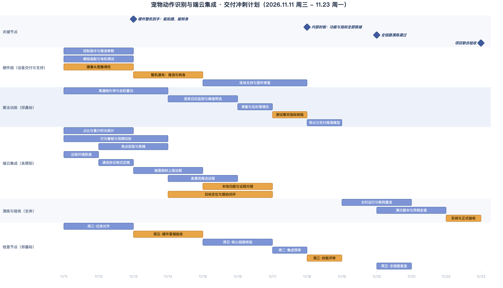

# 交付冲刺计划（2026.11.11 - 11.23）

项目 8 月启动，平台与训练评测链路已就绪（见 [[milestones]] M1）。本文只排**冲刺阶段**剩余工作，不重复前期已完成部分。

## 时间线

- **11.13（周五）**：硬件整机到手，能拍摄、能转身。
- **11.18（周三）**：内部封板，算法双指标与端云七项功能全部就绪。
- **11.20（周五）**：全链路演练通过。
- **11.23（周一）**：项目联合验收。

## 甘特图



矢量版：`management/docs/_assets/gantt_202611.svg`（源码 `gantt_202611.mmd`，同目录另有 `docs/assets/` 副本）。

图例：

| 元素 | 含义 |
| --- | --- |
| 左列文字 | 泳道名，即这条线归谁负责 |
| 蓝色横条 | 常规任务 |
| 橙色横条 | 关键路径上的硬节点，延期会直接吃掉验收时间 |
| 菱形 | 里程碑（当天为节点，不占工期） |
| 竖线 | 图中不画"今天"标记线；本计划从 11.11 当天起算，标记线没有信息量 |

## 三条并行线

### 算法训练（郑鑫裕）

现状：测试集 Top-1 85.75% 已过 75% 目标，但区间级漏检 14.25% 未到 10%，瓶颈集中在 scratching（43.6%）与 drinking（31.7%）。

| 时间 | 工作 | 产出 |
| --- | --- | --- |
| 11.11 - 11.14 | 高漏检类别补样，损失函数加类权重 | 训练配置与数据清单 |
| 11.14 - 11.16 | 重训，逐类召回监控而非只看总准确率 | 逐类召回曲线 |
| 11.16 - 11.17 | 滑窗时长、重叠率、判决阈值调优 | 后处理参数 |
| 11.17 - 11.18 | 测试集核验 Acc ≥ 75%、区间漏检 ≤ 10% | 正式测试报告 |
| 11.18 - 11.19 | 模型导出与推理接口交付 | 权重 + 推理入口 |

口径提醒：漏检按区间级 `1 − recall` 上报；事件级漏检需要动作定位，当前不具备，验收时不能拿片段分类成绩充当事件级结果。

### 硬件组（设备交付）

| 时间 | 工作 |
| --- | --- |
| 11.11 - 11.13 | 控制指令表与推流参数定稿；模组装配与转向电机调试 |
| 11.11 - 11.13 | 摄像头图像调优 |
| 11.13 - 11.15 | 整机通电：确认推流稳定、转身受控、无丢步 |
| 11.15 - 11.18 | 现场支持，处理固件与接线问题 |

交付判据（11.13 前全部到位）：能连续推流、能按指令转到指定角度、接线定义与驱动示例齐全，**且画面质量达标**——白天与夜间都能看清宠物主体，曝光与白平衡随光线变化不漂移，无明显过曝、偏色与运动模糊。

图像调优不只是好看：后续的亮度、对比度、活动幅度与占比指标都从画面直接算，行为识别也吃同一份输入。曝光忽亮忽暗会把同一动作分成两个分布，指标跟着失准。

### 端云集成（吴赟阳）

依赖关系决定顺序：统计、看板回放、亮点抓取**不依赖硬件与远程环境**，先做；远程联通与协议是后续一切的入口；跟拍闭环等硬件到手才能真机联调。

| 时间 | 工作 | 依赖 |
| --- | --- | --- |
| 11.11 - 11.13 | 占比与累计时长统计（身体/面部占比、有效观测时长） | 无，可立即开工 |
| 11.11 - 11.14 | 行为看板与视频回放 | 无，可立即开工 |
| 11.12 - 11.14 | 亮点抓取与剪辑（高置信行为或高活动幅度触发） | 无，可立即开工 |
| 11.11 - 11.12 | 远程环境联通：网络、服务、鉴权打通 | 远程主机可用 |
| 11.12 - 11.13 | 通信协议格式定稿：上报字段与下行指令 | 与算法/硬件确认字段 |
| 11.13 - 11.15 | 画面指标上报远程（亮度、对比度、活动幅度、占比） | 协议定稿 |
| 11.14 - 11.16 | 直播流推送远程 | 远程联通 |
| 11.15 - 11.17 | 本地功能与远程对接（统计、看板、回放、亮点全链路上云） | 上述四项 |
| 11.14 - 11.17 | 目标定位与跟拍闭环（框偏离中心即修正角度） | 11.13 硬件到手 |

协议格式指两件事：本地往上报什么字段（画面指标、行为结果、视频地址），远程往下发什么指令（转向角度、参数调整）。先用文档把字段固定下来、各写一个假实现（mock），两边可以并行开工，不用互相等硬件和模型；后续加字段照常加，不叫冻结需求。

顺序调整的依据：把能独立完成的部分前置，远程联通一旦卡住（网络、鉴权、服务不可用）不能让整条线停着，剩下的时间全部留给必须真机联调的两项——直播推流与跟拍闭环。

## 检查节点

| 节点 | 时间 | 核验什么 | 不通过怎么办 |
| --- | --- | --- | --- |
| 周三·任务对齐 | 11.11 晚 | 接口字段、硬件能否周五交货、算法补样数据是否到位 | 硬件延期即改期到周六，集成先用录播视频 |
| 周五·硬件冒烟验收 | 11.13 17:00 | 推流连续播放 + 电机按指令转动 + 画面质量达标（曝光/白平衡/对焦） | 硬件组周六到场排障，图像调优可与冒烟并行补做 |
| 周日·核心链路核验 | 11.15 18:00 | 统计/看板/回放/亮点四项本地走得通、远程联通与协议定稿、直播推流已经能通 | 跟拍先降级为手动，自动跟拍放到 11.17 前 |
| 周二·集成预审 | 11.17 18:00 | 漏检是否收敛到 10% 附近、四项功能是否已上云、跟拍是否自动对正 | 后处理阈值再调一轮，必要时改口径并如实披露 |
| 周三·内部封板 | 11.18 20:00 | 双指标报告 + 七项功能走通 | 封板后只修 bug，不再加功能 |
| 周五·全链路复盘 | 11.20 18:00 | 30 分钟连续演示不崩、断网能重连 | 修边界用例与告警 |
| 正式验收 | 11.23 | 全部指标与演示场景 | 备录屏与备用样机兜底 |

## 与其他文档的关系

- `management/milestones.md` 里 M3 写 11-15、M4 写 11-30，本文把节点提前到 11.13 / 11.18 / 11.23，落地时需要同步更新该文件的日期。
- 架构与组件职责见 [[architecture]]，算法细节见 [[action-model-design]]。

## 重新渲染

图的产出规范与坑位记录在 `report-figures` skill；本仓的 `scripts/checks/render_doc_assets.sh` 只是它的转发入口。

```bash
# 首次需要 Chrome 内核
npx puppeteer browsers install chrome-headless-shell

# 渲染 PNG + SVG（主题与画布宽度由 report-figures 的 mermaid-render-config.json 控制）
scripts/checks/render_doc_assets.sh management/docs/_assets/gantt_202611.mmd
```
