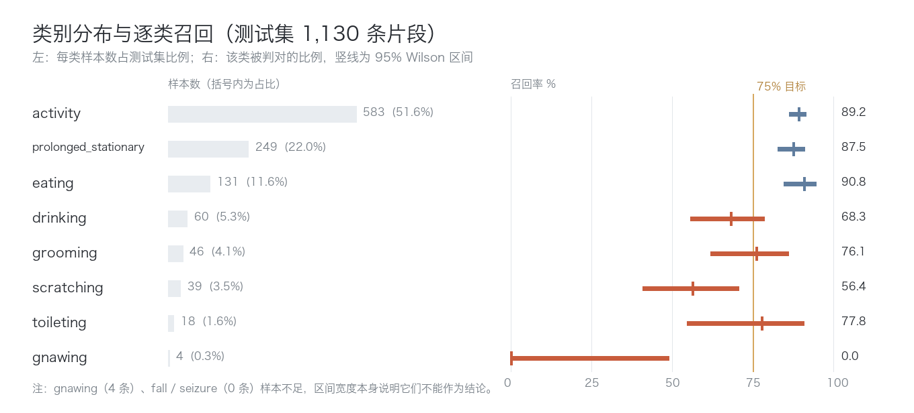
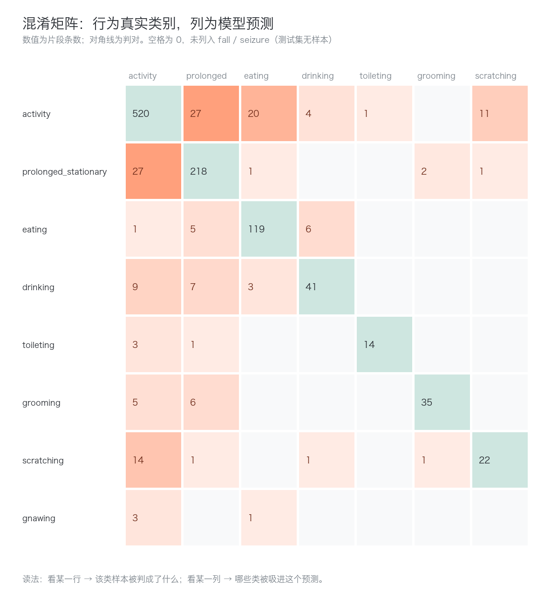
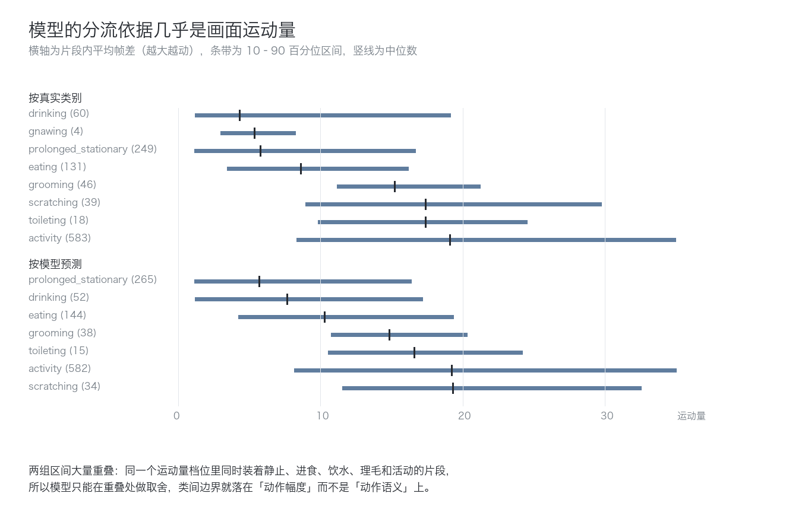
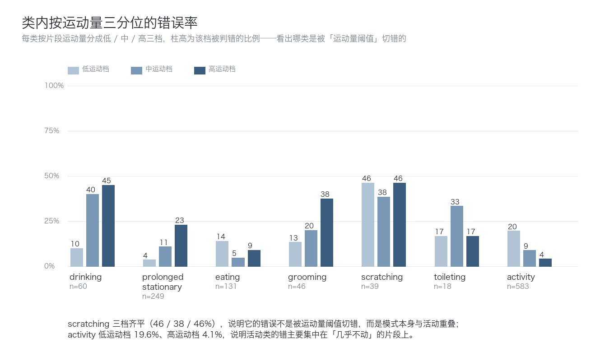
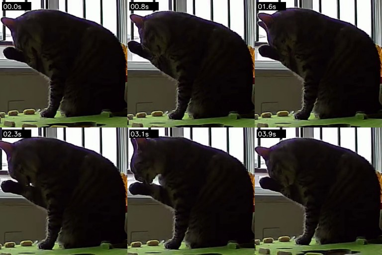
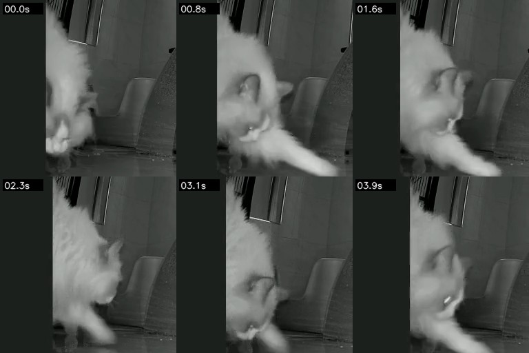
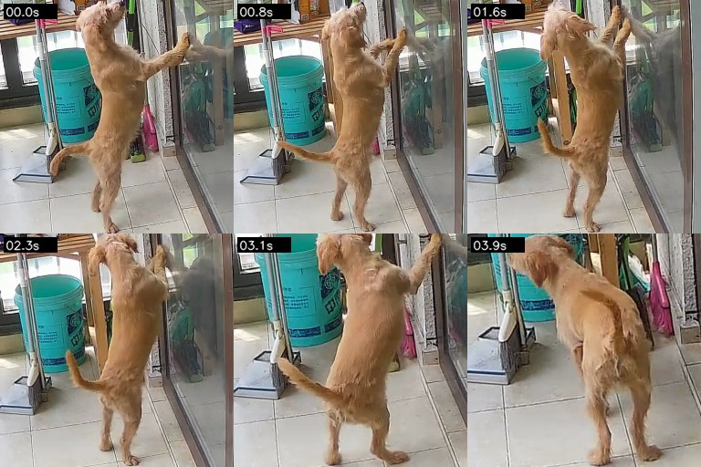
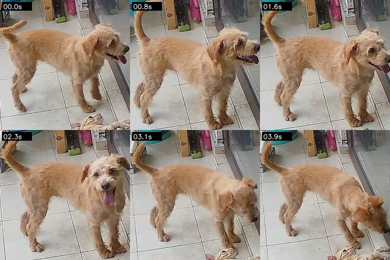
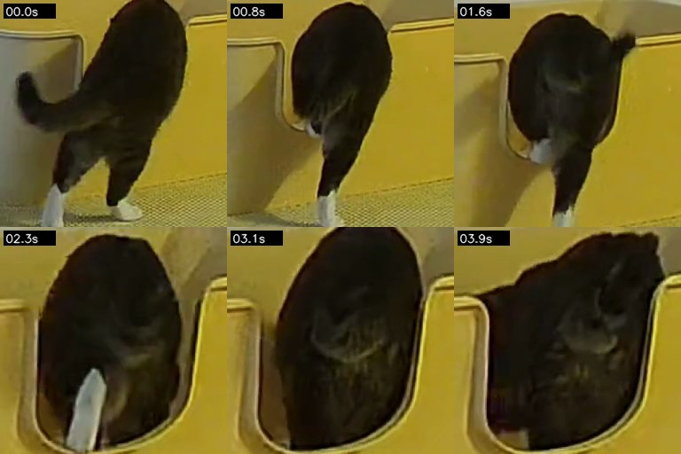
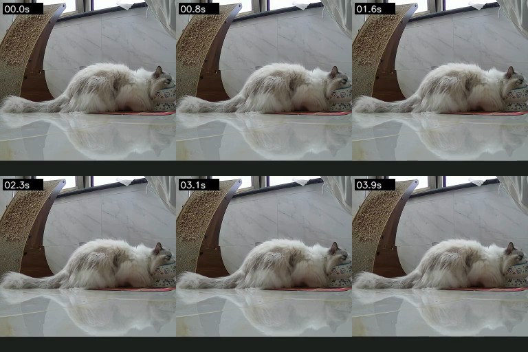

## 背景与目标

本报告是片段分类基线（`clipv9-b`，测试集 1,130 条 4 秒片段 top-1 85.75%）的**逐类拆解**。上一轮已经回答了「整体到没到线」，这一轮只回答「差在哪些类、为什么差」，不训练、不改模型。

十个类别的语义先对齐，否则后面的讨论会跑偏：

| 类别 | 含义 | 常见画面 |
|---|---|---|
| `activity` | 泛活动：走动、站立、张望、上下跳、伸懒腰等一切没被更细类别收走的动作 | 猫/狗在画面里移动、身体姿态频繁变化 |
| `prolonged_stationary` | 长时间静止：趴、蹲、坐，且持续 | 画面几乎无变化 |
| `eating` | 进食 | 低头对碗/粮，咀嚼 |
| `drinking` | 饮水 | 低头对水碗，舔水 |
| `toileting` | 如厕 | 在猫砂盆/指定位置蹲、扒砂、转身 |
| `grooming` | 舔毛理毛（自我清洁）：舌头舔自身、舔爪、舔肛周 | 身体蜷起、头低向自身、舌头反复舔 |
| `scratching` | 抓挠：后爪抓自身，或前爪抓挠家具/门/玻璃 | 短促的爪部往复动作 |
| `gnawing` | 啃咬 | 咬物体 |
| `fall` / `seizure` | 跌落 / 抽搐 | — |

`grooming` 与 `scratching` 是最容易被混为一谈的一对：两者都由「头低向身体 + 爪子动作」构成，区别在于**是舌头还是爪子在发力**。在 256×256 的裁剪片段里，这个区别常常只有几十个像素。

## 当前问题

整体数字（top-1 85.75%）藏着两件事：一是类别分布极不均（`activity` 占测试集 51.6%），二是逐类差距接近 33 个百分点（`eating` 90.8% 对 `scratching` 56.4%）。宏观指标已经给出预警：macro-F1 只有 56.23%、balanced accuracy 54.62%，都远低于 top-1，说明少数类在被系统性地吃掉。

但「哪个类低」不解释「为什么低」。需要回答的是：

1. 错误是不是均匀铺开的？如果不是，集中在哪几条边界上？
2. 几个低分类（`grooming`、`scratching`、`drinking`、`toileting`）的成因是同一个，还是各不相同的病？
3. 「`activity` 变成垃圾桶」这个说法成立吗？如果成立，是模型偏袒还是错误分布使然？
4. 小 support 类别（`toileting` 18 条、`gnawing` 4 条）能不能下结论？

本报告**不做**的事：不提出并验证修复方案，不重训、不调参、不做阈值实验；也不把片段级数字换算成区间级或端到端结论。

## 实验设计

分析对象是 `clipv9-b` 的测试产物 `test_metrics.json`：1,130 条样本，每条带真实标签、预测标签与 10 类分数。全部计算在本机完成，不占 GPU，不改动远端产物。

四类证据：

1. **逐类指标**：TP/FP/FN、precision、recall、F1，并给 recall 与 precision 的 95% Wilson 区间。小 support 类只看点估计会误导——`toileting` 14/18 与 `drinking` 41/60 的区间宽度完全不同。
2. **错误流向**：完整的 10×10 混淆矩阵，以及「每个类的错误流向哪些类」。这张表比矩阵更好读，也是后面所有归因的骨架。
3. **从画面自己算出来的描述量**（不参与训练、与模型输出无关，因此可以当诊断量）：每片段取 10 帧（步长 6，约 0.4 秒间隔），算平均亮度、HSV 饱和度（红外/夜视片段几乎没有饱和度，作为夜视代理，阈值 30）、帧差均值（整体运动量），以及 16×16 分块后的 95 分位帧差（局部动作幅度，用来区分「爪子动」和「整只动物在走」）。
4. **人眼复核**：从每个混淆对里按「置信度最高、同一源视频只取一条」挑候选，再由作者显式选择 9 条视频与 6 张关键帧条纹图放进正文。视频就是模型真正看到的 4 秒片段（256×256、60 帧、15fps），不做任何后期增强。

判定方式：本报告只做描述与归因，因此判据是「数值、错误流向、描述量、人眼复核四者是否指向同一解释」，而不是某条阈值。凡四者不一致的地方，一律写成未确认。

## 结果与分析

### 先看全貌：错误不是均匀铺开的

三类是满分级：`activity` 89.2%、`eating` 90.8%、`prolonged_stationary` 87.5%。四类明显偏低：`grooming` 76.1%、`toileting` 77.8%、`drinking` 68.3%、`scratching` 56.4%。`gnawing` 4 条全错，`fall`/`seizure` 测试集没有样本。

全测试集共 161 个错误，其中 62 个（38.5%）流向了 `activity`。这个数字很容易被读成「模型拿 activity 当垃圾桶」，但它只说明**错误怎么分布**，不说明**预测怎么分布**：模型一共只把 582 条判成 `activity`，而 `activity` 的真实条数是 583——它并没有系统性多报。这两个事实必须一起看，否则会得出错误的修复方向。第四节专门展开。

### 一、模型基本上是按「动得多不多」在分

把模型判成各类的片段按运动量排序，是一条几乎单调的阶梯：`prolonged_stationary` 5.7、`drinking` 7.7、`eating` 10.3、`grooming` 14.9、`toileting` 16.6、`activity` 19.2、`scratching` 19.3（单位是相邻采样帧的平均灰度差）。也就是说，**类间边界很大程度上落在「动作幅度」上，而不是「动作语义」上**。而上下两个面板几乎重合：真实 `drinking` 的中位运动量是 4.3，被判成 `drinking` 的是 7.7——说明这个阶梯不是数据自带的，是模型学出来的。

类内按运动量三分位看错误率，同一件事更清楚：`activity` 从低运动档的 19.6% 降到高运动档的 4.1%；`prolonged_stationary` 反过来，从 3.6% 升到 22.9%；`grooming` 13.3% → 37.5%；`drinking` 10% → 45%。

两条人工核对的片段，正好落在阶梯的两端：

这条片段的真实标签是 `activity`，但六帧画面几乎完全一样——猫站在箱子旁边一动不动。模型判「长时间静止」从画面上讲是对的。反过来：

这条标的是「长时间静止」，可片段里猫已经起身走了。两条合起来说明：**`activity` ↔ `prolonged_stationary` 这对混淆里，有一部分根本不是模型分不清，而是标注区间与 4 秒片段的粒度错配**（区间内既有静止段也有动作段，片段取到了边界附近）。这部分错误靠改模型收不回来，得改切片或改标注粒度。

这一节给后面所有讨论设了一个上限：既然模型主要在按运动量分流，那么凡是「自身运动量区间与别的类重叠」的类别，都会按重叠面积成比例地丢分。`scratching`（中位 17.4、10–90 百分位 8.9–29.7）与 `activity`（中位 19.1、8.3–35.0）几乎完全重叠，就是最坏的情况。

### 二、grooming（舔毛理毛）：精确率高，是因为「报得少但报得准」

`grooming` 的 precision 92.1%（35/38）、recall 76.1%（35/46）。**precision 高不奇怪**：模型只在视觉签名明确时才报这一类——38 次预测里有 35 次对，另外 3 次分别来自 `prolonged_stationary`（2）和 `scratching`（1）。

**recall 低的部分则分成两半，两半的置信度完全不同**：11 个漏报里 6 个流向 `prolonged_stationary`（置信度中位 0.651，只有 33% 超过 0.8），5 个流向 `activity`（置信度中位 0.922，80% 超过 0.8）。前者模型自己也犹豫，后者模型很确定——这说明它们不是同一种失败。

上面这条是最典型的「输入没给到」：猫确实在舔前爪，但裁剪框贴着抬起的爪子，画面里只剩爪子、胡须和一小块身体。模型给出的置信度只有 0.65，与「看不清」一致。

这条是从猫的正后方拍的：能看到尾巴和后腿在动，舔毛本身被躯干挡住。模型把「躯干在动、看不见头部动作」读成活动，也算不上离谱。

结论：`grooming` 的问题更像**裁剪与视角**，而不是类别权重。可回收的部分在三处：裁剪保留头部与前肢（不要只框躯干）、视角筛选、以及「舔毛常常发生在静态姿态里」这个先验（它塌进静止类的那 6 条，本身就是最容易被误当成 `prolonged_stationary` 的样本）。

### 三、scratching（抓挠）：两个低分，是两个不同的病

`scratching` 是全表唯一 precision（64.7%）与 recall（56.4%）都低的类。逐条拆开看，**这两头根本不是同一个原因**：

- **漏报（17 条）**：14 条流向 `activity`（置信度中位 0.963，86% 超过 0.8），分布在 4 个来源（其中 8 条来自无设备前缀的那一组），12 条来自标为 cat 的片段（物种字段的可靠性见第七节）。
- **误报（12 条）**：11 条来自真实 `activity`，其中 9 条来自**同一个来源**（设备前缀 `20000838103643_charw1g`）。

先看漏报侧。抓挠是「小面积、短促」的动作：整只动物几乎不动，只有一只爪子在往复。用 16×16 分块后的局部动作幅度（95 分位）衡量，`scratching` 的中位数是 48.0，`activity` 是 55.9——差得不多。它的类内三分位错误率几乎不随运动量变化（46% / 38% / 46%），这与第一节里 `activity`、`drinking` 那种「越动越准 / 越静越准」的形态完全不同：**它不是被运动量阈值切错的，而是模式本身与活动重叠**。夜间与遮挡再压一层：判错的抓挠片段红外占比 17.6%、中位亮度 85.4，判对的分别是 4.5% 与 121.5。

两条都指向同一件事：抓挠动作在画面里只剩「身体轻微起伏」，模型看到的就是活动。

再看误报侧，这是本节最有信息量的部分。同一个来源（`charw1g`，测试集中 25 条片段）里，出现了这样的组合：

同一种画面（站起、前爪扒门/玻璃），一个区间标 `activity`、另一个标 `scratching`，模型对两者给出同一个答案。这不是模型「看不清」，而是**标注口径在这条边界上不一致**，模型只能二选一，于是必然丢掉一边。

同一来源里还有更单纯的误报：

所以这个来源上叠加了两层问题：一层是「扒门」到底算不算 `scratching` 的标注口径，一层是「狗 + 门/家具」这个组合对该模型有过度触发。

留一来源的敏感性检查把这件事量化了。去掉 `charw1g` 这 25 条：

| 指标 | 全部 1,130 条 | 去掉 `charw1g`（1,105 条） |
|---|---|---|
| top-1（条件） | 85.75% | 86.70% |
| macro recall（7 类） | 78.03% | 76.97% |
| `scratching` recall | 56.4%（39 条） | 46.4%（28 条） |

一个来源同时**帮了 recall、伤了 precision**：该来源 11 条 `scratching` 里判对 9 条（82%），却把 10 条 `activity` 里的 8 条判成 `scratching`。剩下的 28 条抓挠片段 recall 只有 46.4%，说明「猫的抓挠难」是跨来源的普遍现象，而「抓挠 precision 低」主要是一个来源的局部问题。全局指标把这两件事混成了一个数字。

### 四、activity 到底是不是垃圾桶

把 62/161（38.5%）的错误流向 `activity` 摆在前面，很容易得出「模型拿 activity 兜底」的判断。但完整看两侧，结论要改一改：

- **预测分布没有偏袒**：被判成 `activity` 的 582 条里，520 条真的对，precision 89.3%；`activity` 自身 63 个错误里，流向 `prolonged_stationary`（27）和 `eating`（20）的比流向 `scratching`（11）的更多。
- **被吸进 `activity` 的类高度不均**：`scratching` 有 36%（14/39）被吸走，`toileting` 16.7%（3/18），`drinking` 15%（9/60），`grooming` 10.9%（5/46），`eating` 只有 8.3%（1/12）。
- **静止侧也有一个吸引力源**：`grooming` 的 11 个漏报里 6 个流向 `prolonged_stationary`，`drinking` 的 19 个里 7 个，`eating` 的 12 个里 5 个。

所以更准确的说法是：**模型有两个吸引子——高运动量的 `activity` 和低运动量的 `prolonged_stationary`——类别边界由运动量决定，语义细节被淹没**。「垃圾桶」只是高运动量那一侧的表现，把它当成模型偏袒，会导向错误的修复（比如压 activity 的先验），反而会伤到本来就准的 89.2%。

这条 `activity` → `eating` 的错误（该类错误 20 条，第三大）说明了另一条细线：**低头姿态**。模型对「头压向地面」的响应很强，进食、饮水、嗅闻、扒砂都会被拉到一起。这也是 `eating` ↔ `drinking` 互串的来源（drinking→eating 3、eating→drinking 6）。

### 五、toileting（如厕）：77.8% 听起来不错，但只有 18 条

`toileting` 的 precision 93.3%（14/15），recall 77.8%（14/18）。4 个错误：3 个流向 `activity`、1 个流向 `prolonged_stationary`。

两条片段最直观的差别是**容器在不在画面里**：判错的那条只剩「猫蹲着、身体挪动」，判对的那条保留了完整的猫砂盆与序列。这与「模型主要靠运动量和体态」的整体结论一致。

但我只核对了两条样本，**不能**据此断言「容器语境决定判别」。真正能说的是样本量：训练集只有 40 个如厕标注区间，测试 18 条片段，77.8% 的 95% 区间是 54.8%–91.0%。这个宽度不允许下「toileting 已经不错」或「toileting 还差得远」中的任何一个结论。要判断，先补样本。

### 六、drinking（饮水）：68.3%，错误分散在三个方向

19 个错误：`activity` 9、`prolonged_stationary` 7、`eating` 3；precision 78.8%。它有三个特征值得单独说：

**一是「越动越错」**。三分位错误率 10% / 40% / 45%——完全静止的饮水片段判得准，猫在碗边抬头、走动、调整位置的片段判得差。这和其他类「越动越准」的方向相反。

**二是夜视比例最高**。红外片段占 `drinking` 的 53.3%（`eating` 40.5%、`activity` 20.1%、全表 20.7%）。饮水大量发生在夜间，画面信息量本身就更低。

**三是模型靠体态而不是容器**：

两条片段的可见信息量差不多：都看不清碗里是水还是粮。判对的那条靠的是「低伏 + 头贴近固定位置」的体态动力学。一旦体态偏「吃」（头更俯、咀嚼动作），就会翻成 `eating`，这也解释了 `eating`↔`drinking` 的互串。据此，`drinking` 的改进方向更像「分割出头部与碗/水面的相对运动」，而不是继续加类别权重。

### 七、这份数据不允许下的结论

- **`gnawing` / `fall` / `seizure`**：`gnawing` 测试 4 条全错，且四条全是红外极暗画面（中位亮度 48）；`fall` 与 `seizure` 测试样本为 0。三类都不能评估，也无法用「稀有类 recall 低」来论证类别不平衡的影响。
- **置信度不能当预警用**：判错样本的置信度中位数 0.919，67.7% 的错误置信度超过 0.8；判对的是 0.990。模型在错误上很「自信」，本报告没有做阈值实验，只能说「错误不是靠低置信度标出来的」，不能说「加拒识没用」。
- **物种字段不可靠**：测试集元数据里 225/1,130 条标为 dog。我人眼核对了 3 条 dog 标签的片段，其中 1 条画面明显是猫，因此按物种切出来的数字（猫 `scratching` recall 51.6%、狗 75%）只能当「来源差异」的旁证，不作为物种结论。本报告按来源（设备前缀）而不是物种做拆解，就是这个原因。
- **片段级 ≠ 区间级**：全部数字都是 4 秒片段口径。端到端与区间级结论以项目口径为准（当前估计 72.9%），本报告没有做区间聚合。

## 结论与下一步

**已验证的事实**

1. 错误不是均匀铺开的：三条边界吞掉了大部分错误——运动量高低（`activity` ↔ `prolonged_stationary`）、低头体态（`eating` ↔ `drinking` ↔ `activity`）、以及爪部动作与泛活动的重叠（`scratching` ↔ `activity`）。
2. 模型大体按画面运动量分流，类内错误率随运动量单调变化（除了 `scratching`，它三档齐平）。
3. 一部分错误来自标注粒度：`activity`→`prolonged_stationary` 里有人眼也看不出动作的片段，`prolonged_stationary`→`activity` 里有猫已经起身的片段。
4. `scratching` 的两头是两件事：漏报是跨来源的可见性问题（猫、夜间、遮挡），误报高度集中在单一来源，且该来源存在「同一画面两种标注」的口径边界。
5. `grooming` 的 precision 高是「只在签名明确时才报」的结果，漏报以裁剪/视角丢失信号为主；`toileting`、`drinking` 的低分受样本量与夜视比例限制，当前数据不支持更细的结论。

**未验证**（本报告不提供证据）

改裁剪策略、引入容器/水位语境、按来源重训或重标、阈值拒识、补标稀有类——都尚未实验。本报告只给诊断与优先级，不作为任何改动的依据。

**下一步（按预期收益/成本排序）**

1. **复核 `charw1g` 这 25 条片段的 `activity` / `scratching` 标注口径**（纯人工，成本最低）。它同时决定 `scratching` precision 的「真上限」，以及全局 top-1 里约 1 个百分点归属。
2. **裁剪策略对照实验**：保留头部与前肢，而不是只框躯干最大的正方形。`grooming` 与 `scratching` 的错误都指向「信号在框外」，这是第一个该被验证的假设。
3. **补齐 `toileting` 与 `drinking` 的场景多样性**：如厕要包含猫砂盆可见的视角；饮水要补白天、容器可见的片段，避免模型只学到夜间体态。两类都是 18–60 条量级，先把样本补到能给出可解释区间宽度。
4. **按区间口径复核片段级成绩**：本报告暴露了「片段与标注区间粒度错配」，需要先确认这类错配的规模，再谈端到端数字。

以上 2–4 项都要按实验流程先立 change、跑对照，本报告只负责把问题定位到这里。

## 附录：配置与完整数据

### 环境与配置

- 模型: VideoMAEv2-B（K710 蒸馏预训练），clipv9-b 训练产物 results/cat_clip_v9/videomaev2_b/train20（pet）
- 数据集: cat_clip_v9 test split：1,130 条 60 帧 256×256 渲染片段（train 4,384 / val 1,836）
- 配置: mmaction2 tools/test.py，16 帧 × 224，十类，seed 0；本报告分析全在本机 CPU 完成
- 运行时间戳: 模型测试 2026-11-07 08:29（pet）；本报告分析 2026-11-12（本机）
- 执行入口: python3 scripts/checks/analyze_clip_class_errors.py stats|cases|media；python3 scripts/checks/plot_clip_class_errors.py；生成报告 .agents/skills/experiment/scripts/build_report.py
- 随机种子: 0（训练）；本报告统计部分无随机性

### 局限与边界

- 单位与口径：全部指标是**片段级**（4 秒、60 帧、256×256），不是区间级或端到端；端到端数字仍以项目口径（可用率 × 条件准确率，当前估计 72.9%）为准。
- 样本量：`gnawing` 测试 4 条（全错，全为红外暗画面）、`fall`/`seizure` 0 条，三类不可评估；`toileting` 18 条、`scratching` 39 条，点估计的 95% 区间分别宽到 54.8–91.0% 与 41.0–70.7%。
- 归因强度：运动量、亮度、红外占比都是从画面算的描述量，只能说明「错误与这些量共变」，不是因果证明。人眼复核只覆盖 15 条片段（9 视频 + 6 关键帧图），用于解释机制，不代表该类样本的整体分布。
- 标注口径：`charw1g` 来源的 `activity`/`scratching` 边界是否属于标注错误，本报告未裁定——只指出同一视觉模式下存在两种标签，需要人工复核。
- 元数据：`species` 字段经人眼抽查不可靠（3 条 dog 标签里 1 条画面是猫），因此未做物种层面的结论。
- 未做：阈值/拒识实验、区间聚合、多 seed 复现（分析对象是单次测试产物）。

### 来源与核查

- run 产物：results/cat_clip_v9_analysis/analysis
- 详细来源见 manifest 各条目的 source 字段；单位、样本量与局限见 manifest 的 metrics 条目。
- 指标与趋势见 metrics.json（series 折线 + tables 指标表）。

