## 背景与目标

七类区间基线（TSM 79.19%、VideoMAEv2-B 81.90%）吃的是整帧画面：2880×1620 缩到短边 256 后，猫只剩十几个像素。这条输入路径把分类上限锁死，也解释了检测环节为什么总在漏检。

本文记录十类版本的两步。第一步把标签从七类拆成十类（`abnormal` 拆成 `scratching`、`gnawing`、`fall`、`seizure`，其余沿用），并把输入表示换成「按个体轨迹裁剪的 60 帧片段」：检测框先经单流 OC-SORT 关联成轨迹，再插值成逐帧框、离线渲染成 256×256 片段，训练直接读片段文件。第二步不训练、不改模型，只做逐类错误拆解，回答「差在哪些类、为什么差」。

十类的语义先对齐，否则后面讨论会跑偏：

| 类别 | 含义 | 常见画面 |
| --- | --- | --- |
| `activity` | 泛活动：走动、站立、张望、上下跳、伸懒腰等没被更细类别收走的动作 | 身体在画面里移动、姿态频繁变化 |
| `prolonged_stationary` | 长时间静止：趴、蹲、坐且持续 | 画面几乎无变化 |
| `eating` | 进食 | 低头对碗/粮，咀嚼 |
| `drinking` | 饮水 | 低头对水碗，舔水 |
| `toileting` | 如厕 | 在猫砂盆/指定位置蹲、扒砂、转身 |
| `grooming` | 舔毛理毛：舌头舔自身、舔爪、舔肛周 | 身体蜷起、头低向自身、舌头反复舔 |
| `scratching` | 抓挠：后爪抓自身，或前爪抓挠家具/门/玻璃 | 短促的爪部往复动作 |
| `gnawing` | 啃咬 | 咬物体 |
| `fall` / `seizure` | 跌落 / 抽搐 | — |

`grooming` 与 `scratching` 最容易被混为一谈：两者都由「头低向身体 + 爪子动作」构成，区别在于**是舌头还是爪子在发力**；在 256×256 的裁剪片段里，这个区别常常只有几十个像素。

## 当前问题

训练这一步要回答：把输入从整帧换成按轨迹裁剪的片段，条件准确率能提高多少，端到端能不能达到 75%。诊断这一步要回答另外几件事：错误是不是均匀铺开的；几个低分类（`grooming`、`scratching`、`drinking`、`toileting`）的成因是同一个还是各不相同；「`activity` 当垃圾桶」这个说法成不成立；小 support 类能不能下结论。

诊断不提出并验证修复方案，不重训、不调参、不做阈值实验，也不把片段级数字换算成区间级结论。

## 实验设计

**训练对照（2026-11-07）。** 同一份 7,350 条片段、同一 seed、同一配方（VideoMAEv2-B、16 帧、间隔 3、256→224、十类、梯度累积 4、20 epoch、每 2 轮验证），只改输入表示：A 臂读整帧，B 臂读离线渲染的裁剪片段。片段框来自单流 OC-SORT 轨迹：取覆盖片段帧数最多的轨迹、插值到逐帧、端点保持、5 帧滑动平均。7,554 条片段里 204 条所在视频没有可用锚点（记 `no_track_points`），实际渲染 7,342 条，导出 train 4,384 / val 1,836 / test 1,130。

**逐类诊断（2026-11-12）。** 分析对象是 B 臂的测试产物 `test_metrics.json`（1,130 条，每条带真实标签、预测标签与 10 类分数），全部计算在本机完成。四类证据：逐类 TP/FP/FN 与 Wilson 区间；完整 10×10 混淆矩阵与「每个类的错误流向」；从画面独立算出的描述量（每片段取 10 帧，算平均亮度、HSV 饱和度作夜视代理、帧差均值作运动量、16×16 分块 95 分位帧差作局部动作幅度，这些量不参与训练，因此可当诊断量）；以及人眼复核（按「置信度最高、同一源视频只取一条」挑候选，作者显式选择案例；视频就是模型真正看到的 4 秒片段，不做后期增强）。另做 1 例区间对照：把标注区间整段按训练同款裁剪渲染，检查错判是模型分不清还是窗口取错了位置。

判定方式是四者互证：数值、错误流向、描述量、人眼复核指向同一解释才写成结论，否则写「未确认」。

## 结果与分析

### 整帧臂的提前终止

A 臂在第 4 轮验证（`Epoch(val) [4]`）后由资源守卫终止，验证 top-1 75.95%、macro-F1 41.36%、balanced 43.35%，产物保留在 `results/cat_clip_v8/train20/`。4 轮不足以与 B 臂的 20 轮直接比较，只能看方向。更要紧的是它证实了一件事：整帧臂读的是整帧而非裁剪，片段索引里只有视频与帧范围，检测框根本没参与输入——所以它连「裁剪是否有效」都不能回答。

### 裁剪片段的整体结果

B 臂 20 轮完成（rc=0，3,322 秒），最优检查点是第 8 轮（验证 top-1 83.82%、macro-F1 52.22%）。冻结测试只跑一次：1,130 条片段 top-1 85.75%、macro-F1 56.23%、balanced accuracy 54.62%。

训练 loss 降到 0.06 而验证 macro-F1 在第 8 轮见顶、之后在 50–52% 波动，是明确的过拟合形态，也说明「训练更久」不是当前的杠杆。读片段文件让单迭代降到 0.135 秒、`data_time` 0.003 秒，比读整帧快一个数量级——这部分收益与准确率无关，但对重跑成本有影响。

逐类准确率是满分级与塌陷级并存：`eating` 90.8%、`activity` 89.2%、`prolonged_stationary` 87.5% 三类接近满分；`toileting` 77.8%、`grooming` 76.1%、`drinking` 68.3%、`scratching` 56.4% 明显偏低。`gnawing` 4 条全错，`fall` 与 `seizure` 测试样本为 0。

### 目标口径与达标状态

项目中期目标是「闭集准确率 ≥75%、漏检率 ≤10%」，这两个数不在同一行指标上。本报告涉及四个口径：

| 口径 | 数值 | 定义 | 与目标的关系 |
| --- | --- | --- | --- |
| 条件 top-1 准确率 | 85.75% | 留出测试集 1,130 条片段判对的比例 | 达标判定用这个数，≥75% 已达成 |
| 端到端准确率（估计） | 72.9% | 可用率 85.03% × 条件准确率 85.75%，分母是全部 3,927 条标注、失败计错 | 诊断量，未达 75% |
| 逐类准确率 | 见附录 | 该类样本判对比例，数学上等于该类召回率 | 逐类没有独立验收线；其补数即该类漏检率 |
| macro-F1 / balanced | 56.23 / 54.62 | 类间等权平均，不可评估类计 0 | 诊断量，用来看少数类被吃掉多少 |

也就是说：「75% 准确率」指整体条件 top-1，已达成；「漏检率 10%」指逐类漏检（1 − 该类准确率），整体 14.25% 未达成，最差的是 `scratching` 43.6% 与 `drinking` 31.7%。后面所有逐类数字按这个划分读：看的是「该类漏检多少」，不是各有一条 75% 的线。

### 错误分布概览

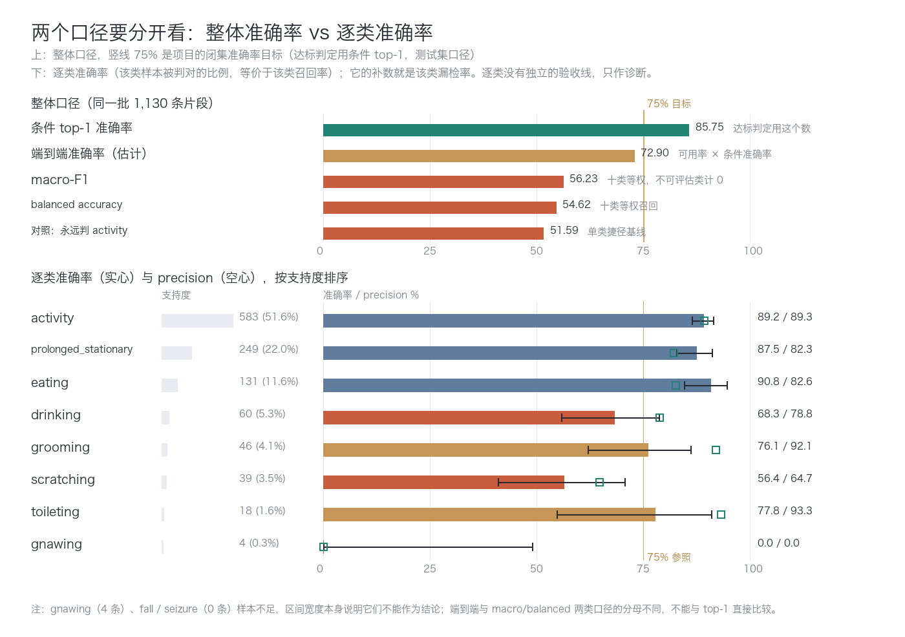

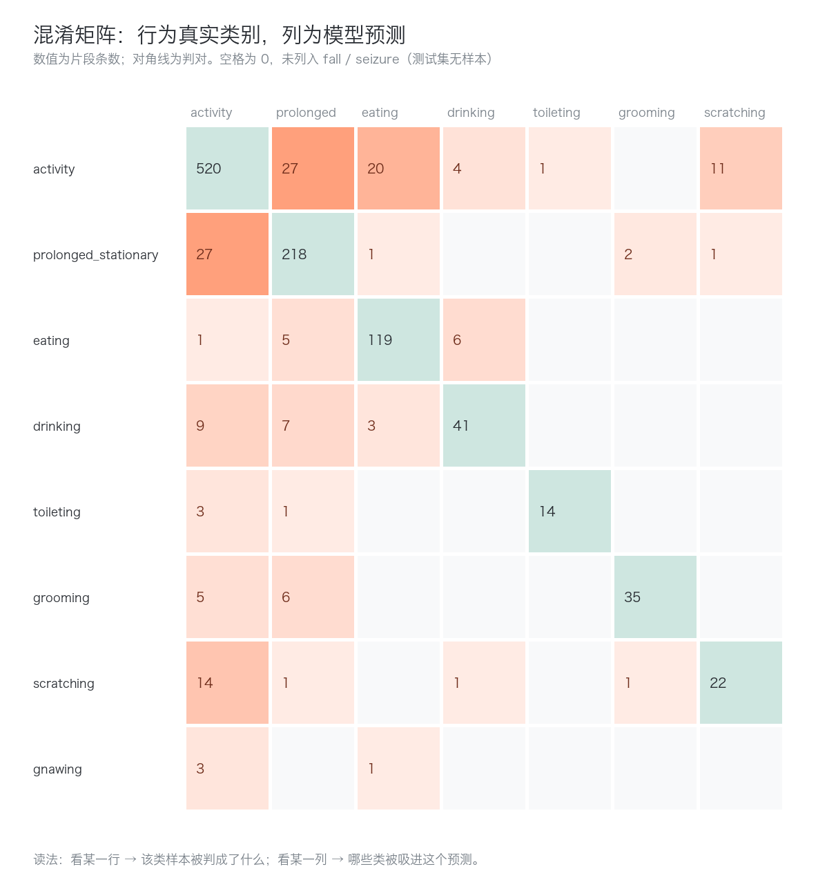

全测试集 161 个错误中，62 个（38.5%）流向了 `activity`。这个数字容易被读成「模型拿 activity 当垃圾桶」，但它只说明**错误怎么分布**，不说明**预测怎么分布**：模型一共只把 582 条判成 `activity`，而 `activity` 真实条数是 583——它并没有系统性多报。两个事实必须一起看，否则会得出错误的修复方向。

### 模型主要依据运动量

把模型判成各类的片段按运动量排序，是一条几乎单调的阶梯：`prolonged_stationary` 5.7、`drinking` 7.7、`eating` 10.3、`grooming` 14.9、`toileting` 16.6、`activity` 19.2、`scratching` 19.3（单位是相邻采样帧的平均灰度差）。类间边界很大程度上落在「动作幅度」上，而不是「动作语义」上。真实类别与预测类别两条曲线几乎重合，说明这个阶梯不是数据自带的，是模型学出来的。

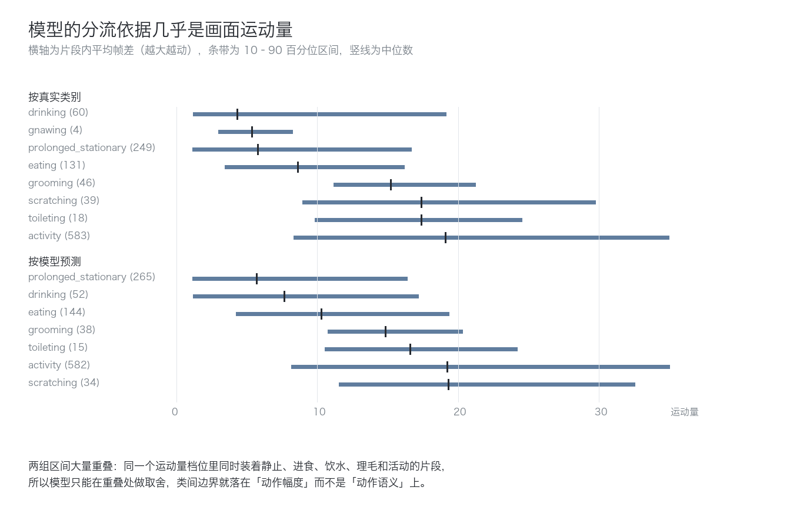

类内按运动量三分位看错误率，同一件事更清楚：`activity` 从低运动档 19.6% 降到高运动档 4.1%；`prolonged_stationary` 反过来，从 3.6% 升到 22.9%；`grooming` 13.3% → 37.5%；`drinking` 10% → 45%。

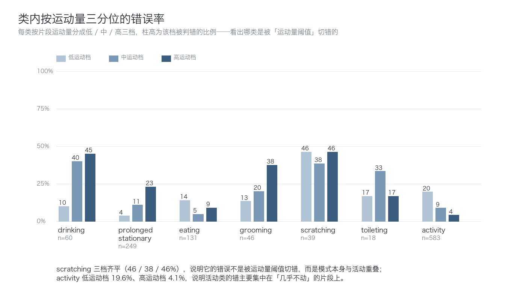

这条「按运动量分流」给后面所有讨论设了上限：凡是自身运动量区间与别的类重叠的类别，都会按重叠面积成比例地丢分。`scratching`（中位 17.4、10–90 百分位 8.9–29.7）与 `activity`（中位 19.1、8.3–35.0）几乎完全重叠，就是最坏的情况。

两条对立的片段正好落在阶梯两端，而它们的错判指向标注与取样的粒度：

这条片段的真实标签是 `activity`，但六帧画面几乎完全一样——猫站在箱子旁边一动不动。模型判「长时间静止」从画面上讲是对的。把标注区间整段拉出来看，就能看到「为什么标成 activity」：这条样本的区间是帧 1–235（15.67 秒），模型看到的 60 帧只是其中一段。

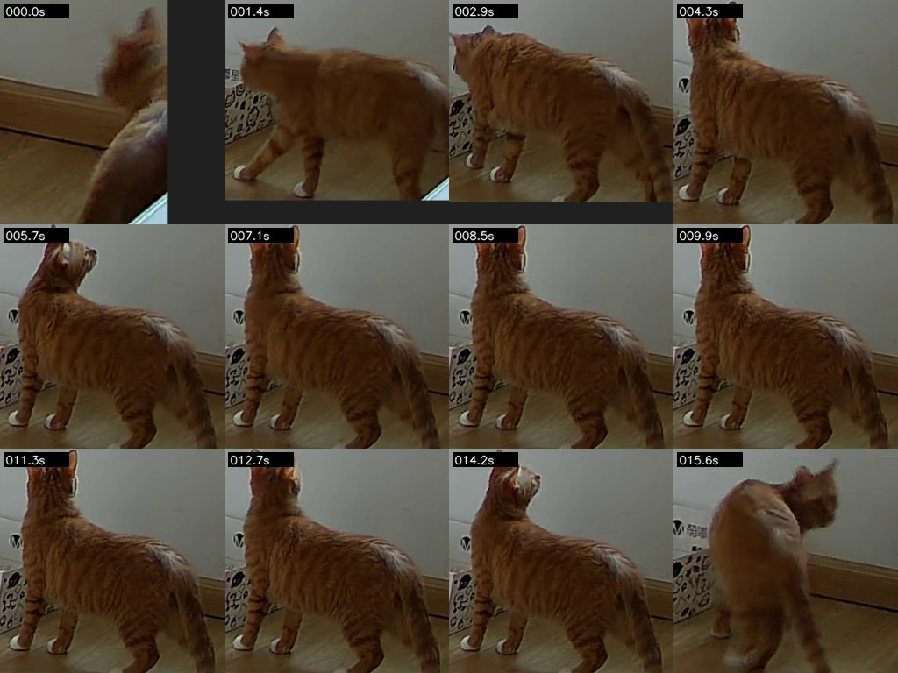

对着这两件素材，问题首先在标注本身，不只是取样：这 15.7 秒里只有前约 4 秒是活动，之后近 10 秒猫基本站着不动——按项目自己的类别定义，后一段应当标成 `prolonged_stationary`。把整段打成一个 `activity` 区间，等于让一个标签盖住了两段不同行为。

区间内的逐帧运动量把这个判断量化了（下图左，0.5 秒一桶）：0–4.3 秒在 4–7 之间起伏（走动），4.3–14.5 秒掉到 0.05–2.6（站定，中间几次小起伏是转头），最后 1.2 秒回到 4–5.5（再次起步）。这段区间至少应切成两段：`[1, 65]` 活动 + `[66, 218]` 长时间静止，末段再议。

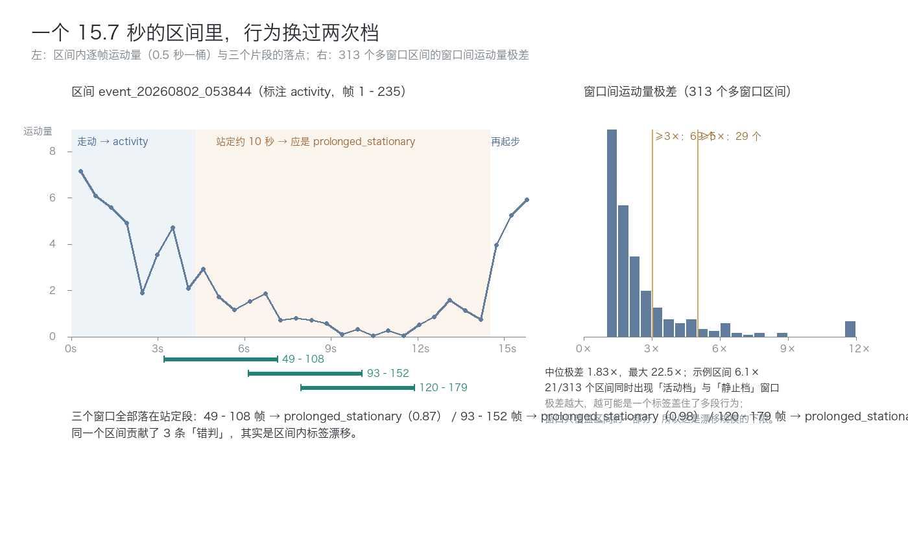

这不是孤例。测试集 313 个贡献多个窗口的区间里，窗口间运动量极差中位数是 1.83 倍；69 个（22%）在 3 倍以上、29 个（9.3%）在 5 倍以上，21 个（6.7%）同时出现「活动档」（≥15）与「静止档」（≤5）的窗口。这是下限：窗口只覆盖区间的一部分，没被覆盖的部分看不到。模型看的窗口是帧 120–179（7.9–11.9 秒），正好落在中间那段站定时间里，而这个区间在测试集里不止一条：三个窗口（49–108、93–152、120–179）的运动量分别是 6.88 / 2.70 / 1.13，全部取在静止段，于是三条全判成 `prolonged_stationary`。这里叠了两层问题——标注把两段行为合成一个区间，取样又把窗口放在静止段；就那 4 秒画面而言，模型判对了。

顺带暴露一个更普遍的问题：**片段不是独立样本**。测试集 1,130 条片段只来自 484 个标注区间（171 个区间给 1 条、93 个给 2 条、107 个给 3 条、113 个给 4 条）。所以逐类 support 是「片段数」，判断掌握程度要同时看「独立区间数」，区间级置信区间比片段级宽得多。

### grooming：头部信号被裁掉

`grooming` 的 precision 92.1%（35/38）、recall 76.1%（35/46）。precision 高不奇怪：模型只在视觉签名明确时才报这一类，38 次预测里 35 次对，另外 3 次分别来自 `prolonged_stationary`（2）与 `scratching`（1）。

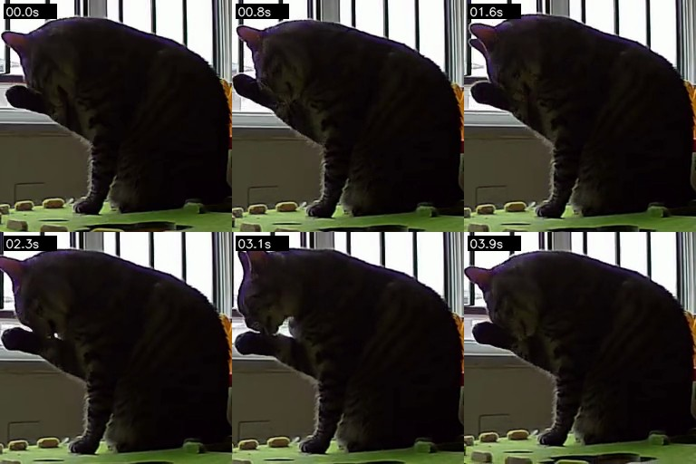

recall 低的部分分成两半，两半的置信度完全不同：11 个漏报里 6 个流向 `prolonged_stationary`（置信度中位 0.651，只有 33% 超过 0.8），5 个流向 `activity`（中位 0.922，80% 超过 0.8）。前者模型自己也犹豫，后者模型很确定——它们不是同一种失败。

这条是最典型的「输入没给到」：猫确实在舔前爪，但裁剪框贴着抬起的爪子，画面里只剩爪子、胡须和一小块身体，置信度只有 0.65，与「看不清」一致。流向 `activity` 的那几条则多是镜头在猫背后、舔毛被躯干挡住。

结论：`grooming` 的问题更像**裁剪与视角**，不是类别权重。可回收的地方在三处：裁剪保留头部与前肢（不要只框躯干）、视角筛选、以及「舔毛常发生在静态姿态里」这个先验（塌进静止类的那 6 条本身就是最容易被误当成 `prolonged_stationary` 的样本）。

### scratching：与直立扒抓绑定

`scratching` 是全表唯一 precision（64.7%）与 recall（56.4%）都低的类：39 条判对 22 条，17 条漏报（14 条流向 `activity`），另有 12 条误报。只看这两个数判断不出该改什么，所以把测试集的抓挠片段按三个方向取样摆在一起：漏判 7 条、判对 7 条、误报 6 条，每段取第 30 帧并标注置信度、亮度与运动量。

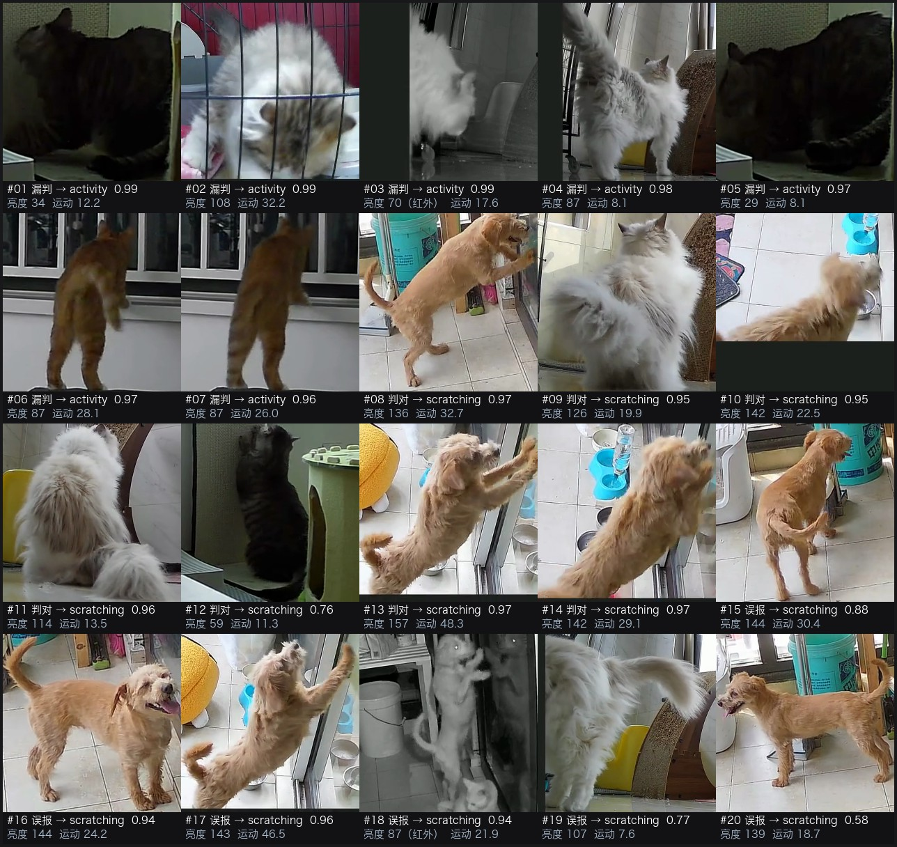

**判对的 7 条有同一个构型**：动物直立、前爪抵住某个竖直面（门、窗、镜子、猫爬架、墙角）反复扒抓，画面亮（亮度 114–157），动作幅度大（运动量 11–48）。这类画面里「哪只爪子在发力」是看得见的。

**判错的 7 条是另一种动作**：猫伏地或蹲着，头扭向自身——用后爪挠耳、挠身，或啃咬自己的腿；动作局部、幅度小，画面偏暗（亮度 29–108，其中 #03 是红外夜视）。

也就是说：**模型把 `scratching` 学成「直立扒竖直面」，而猫的「自挠」被它读成了 activity**。数据上和这个读法一致：判错侧亮度中位 85.4、红外占比 17.6%，判对侧是 121.5 / 4.5%；两侧的局部动作幅度几乎一样（16×16 分块的 95 分位中位 48.0 对 55.9），说明自挠的爪部动作在 256×256 里只占很小一块面积，被躯干运动淹掉。它错得也很自信：判错置信度 0.96–0.99，判对 0.76–0.97，两边没有区分度。

这条边界本身也不干净：#06/#07 是猫对着窗直立扒抓，同样被判成 activity（0.97 / 0.96）。所以「直立扒抓」模型也不是每次都抓得住，还取决于画面是否够亮、爪子是否贴着画面边缘。

**误报组把这件事闭环了**：12 条误报里 11 条来自真实 `activity`，其中 9 条集中在同一个来源（设备前缀 `20000838103643_charw1g`，25 条测试片段）。这 6 条的画面与「判对」组是同一个构型——狗或猫直立、前爪抵住玻璃门/墙/碗架、幅度大、画面亮（亮度 87–144、运动 7.6–46.5），模型置信度 0.58–0.96，差别只在源标注：这些片段标的是 `activity`。

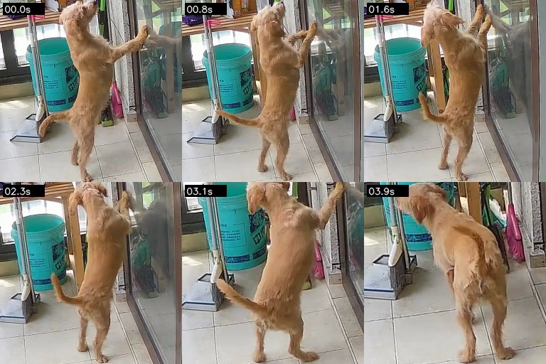

同一种画面（站起、前爪扒门/玻璃），一个区间标 `activity`、另一个标 `scratching`，模型对两者给出同一个答案。这不是「看不清」，而是标注口径在这条边界上不一致，模型只能二选一，必然丢掉一边。同一来源里还有更单纯的误报：

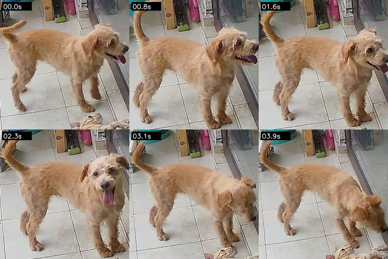

所以这个来源上叠了两层问题：一层是「扒门」算不算 `scratching` 的标注口径，一层是「狗 + 门/家具」对该模型有过度的触发。

### 训练集标签的构型错配

这个「构型 = 类别」的绑定不是凭空学来的，训练集本身就长这样：

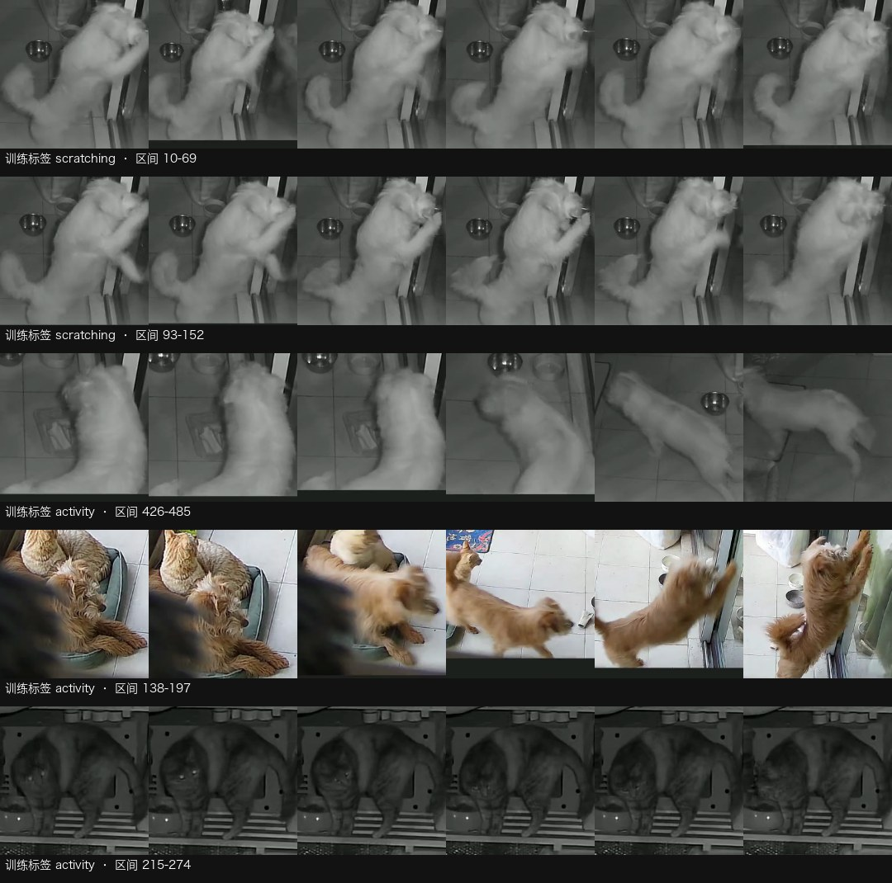

三段完整片段（各 4 秒，都是**训练数据**，未经挑选改动）：

- 训练集 `scratching` 共 236 条片段，其中 159 条（67%）来自 `charw1g` 这一个来源，画面就是「狗直立、前爪扒门/墙」；同来源另有 65 条 `activity` 片段。
- 同一条录制 `event_20260321_185615` 里，前段（区间 1–244）标 `scratching`，后段（456–485）标 `activity`——前段持续扒门、后段扒完走开，这一条分得开。
- 但另一条录制的 `activity` 片段（区间 138–197）里，前段猫在窝里、中段狗走过、末段狗直立扒玻璃门——同一个构型被包在 `activity` 区间里。模型在测试集上把这批画面判成 `scratching`，在训练集里其实已经见过。

也就是说：`scratching` 在训练数据里基本等价于「直立扒竖直面」，且这个等价关系建立在单一来源上；同一来源的 `activity` 里又混着同样的画面。这不是模型容量问题，是类别定义与标注粒度问题——短则一个 4 秒窗口，长则一整条录制，只要动作在区间内换过，标签就只能二选一。

留一来源的敏感性检查把这件事量化了。去掉 `charw1g` 这 25 条：top-1 从 85.75% 升到 86.70%，macro recall（7 类）从 78.03% 降到 76.97%，`scratching` recall 从 56.4%（39 条）降到 46.4%（28 条）。一个来源同时帮了 recall、伤了 precision：该来源 11 条 `scratching` 里判对 9 条（82%），却把 10 条 `activity` 里的 8 条判成 `scratching`。剩下的 28 条抓挠片段 recall 只有 46.4%，印证「猫的自挠难」是跨来源的普遍现象，而「抓挠 precision 低」主要是一个来源的局部问题。全局指标把这两件事混成了一个数字。

### activity 的错误汇聚

把 62/161（38.5%）的错误流向 `activity` 摆在前面，很容易得出「模型拿 activity 兜底」的判断。完整看两侧，结论要改：

- 预测分布没有偏袒：被判成 `activity` 的 582 条里 520 条真的对（precision 89.3%）；`activity` 自身 63 个错误里，流向 `prolonged_stationary`（27）与 `eating`（20）的比流向 `scratching`（11）的更多。
- 被吸进 `activity` 的类高度不均：`scratching` 36%（14/39）、`toileting` 16.7%（3/18）、`drinking` 15%（9/60）、`grooming` 10.9%（5/46）、`eating` 8.3%（1/12）。
- 静止侧也有一个吸引源：`grooming` 的 11 个漏报里 6 个流向 `prolonged_stationary`，`drinking` 的 19 个里 7 个，`eating` 的 12 个里 5 个。

更准确的说法是：**模型有两个吸引子——高运动量的 `activity` 与低运动量的 `prolonged_stationary`——类别边界由运动量决定，语义细节被淹没**。「垃圾桶」只是高运动量那一侧的表现；把它当成模型偏袒会导致错误的修复（比如压 activity 的先验），反而伤到本来就准的 89.2%。

还有一条细线是「低头姿态」：`activity` → `eating` 是该类第三大错误（20 条），红外下猫弓背低头贴近地面时体态与进食高度相似。模型对「头压向地面」的响应很强，进食、饮水、嗅闻、扒砂会被拉到一起——这也解释了 `eating` ↔ `drinking` 的互串（drinking→eating 3、eating→drinking 6）。

### toileting：样本量不足

`toileting` 的 precision 93.3%（14/15）、recall 77.8%（14/18），4 个错误里 3 个流向 `activity`、1 个流向 `prolonged_stationary`。人眼比对的两条片段最直观的差别是**容器在不在画面里**：判错的那条只剩「猫蹲着、身体挪动」，判对的那条保留了完整的猫砂盆与进盆、蹲下、转身扒砂的序列。

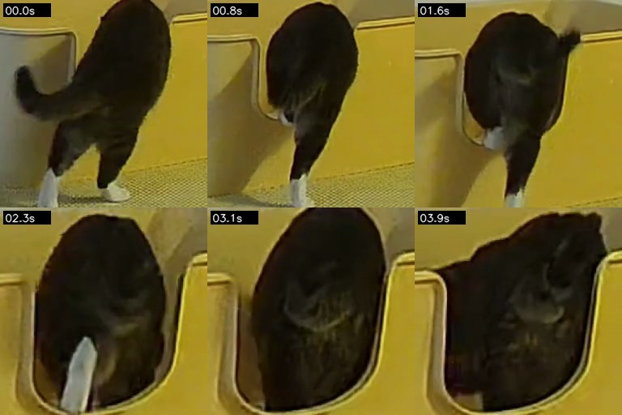

但只核对了这两条，不能据此断言「容器语境决定判别」。真正能说的是样本量：训练集只有 40 个如厕标注区间，测试 18 条片段，77.8% 的 95% 区间是 54.8%–91.0%。这个宽度不允许下「toileting 已经不错」或「还差得远」中的任何一个结论。

### drinking：夜视与运动量影响

19 个错误：`activity` 9、`prolonged_stationary` 7、`eating` 3；precision 78.8%。三个特征值得单独说。

一是「越动越错」：三分位错误率 10% / 40% / 45%——完全静止的饮水片段判得准，猫在碗边抬头、走动、调整位置的片段判得差。这与其他类「越动越准」的方向相反。

二是夜视比例最高：红外片段占 `drinking` 的 53.3%（`eating` 40.5%、`activity` 20.1%、全表 20.7%）。饮水大量发生在夜间，画面信息量本身更低。

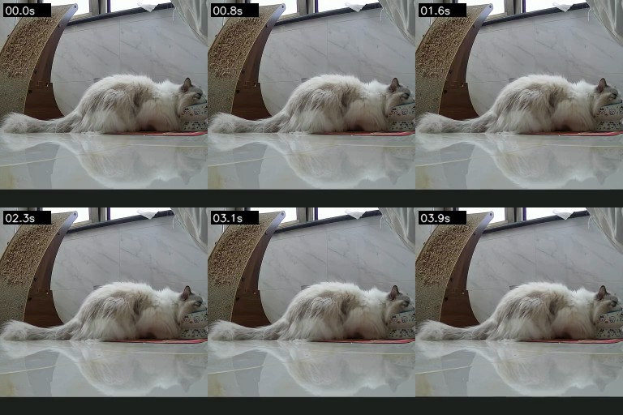

三是模型靠体态而不是容器：判错的这条看不清水碗里是什么，判对的那条同样看不清，靠的是「低伏 + 头贴近固定位置」的体态动力学；一旦头更俯、出现咀嚼动作，就会翻成 `eating`。据此，`drinking` 的改进方向更像「分割出头部与碗/水面的相对运动」，而不是继续加类别权重。

### 不可评估的范围

- `gnawing` / `fall` / `seizure`：`gnawing` 测试 4 条全错，且全是红外极暗画面（中位亮度 48）；`fall` 与 `seizure` 测试样本为 0。三类都不能评估，也无法用「稀有类 recall 低」论证类别不平衡的影响。
- 置信度不能当预警用：判错样本的置信度中位数 0.919，67.7% 的错误置信度超过 0.8；判对的是 0.990。本报告没做阈值实验，只能说「错误不是靠低置信度标出来的」，不能说「加拒识没用」。
- 物种字段不可靠：测试元数据里 225/1,130 条标为 dog，人眼核对 3 条 dog 标签中有 1 条画面明显是猫。因此按物种切出来的数字只能当来源差异的旁证，本报告按设备前缀而不是物种做拆解。
- 片段级 ≠ 区间级：全部数字都是 4 秒片段口径；端到端与区间级结论以项目口径为准，本报告没有做区间聚合。

## 结论与下一步

**已验证**

1. 输入表示换成裁剪片段后，条件 top-1 到 85.75%，按用户裁定口径（留出子集条件准确率）已过 75%；端到端估计 72.9%、区间级漏检 14.25% 未达 10%。
2. 整帧臂只有 4 轮（75.95%），不能与 20 轮直接比较，也不构成「裁剪优于整帧」的证据——那一轮连检测框都没进输入。
3. 错误不是均匀铺开的：三条边界吞掉大部分错误——运动量高低（`activity` ↔ `prolonged_stationary`）、低头体态（`eating` ↔ `drinking` ↔ `activity`）、爪部动作与泛活动的重叠（`scratching` ↔ `activity`）。
4. 模型大体按画面运动量分流，类内错误率随运动量单调变化（`scratching` 除外，三档齐平）。
5. 一部分错误来自标注粒度：`activity`→`prolonged_stationary` 里有人眼也看不出动作的片段，`prolonged_stationary`→`activity` 里有猫已经起身的片段。
6. `scratching` 的两头是两件事：漏报是跨来源的可见性问题（猫、夜间、遮挡），误报高度集中在单一来源且该来源存在「同一画面两种标注」的口径边界。`grooming` 的 precision 高来自「只在签名明确时才报」，漏报以裁剪/视角丢失信号为主。
7. `toileting` 与 `drinking` 的低分受样本量与夜视比例限制，当前数据不支持更细的结论。

**未验证**（本报告不提供证据）：改裁剪策略、引入容器/水位语境、按来源重训或重标、阈值拒识、补标稀有类，都还没做实验。

**下一步（按预期收益/成本排序）**

1. 先按行为变化切分区间再评估：21 个区间（6.7%）还能看到「活动档」与「静止档」并存，需要按运动量或人工复核切成多段重贴标签，然后按区间口径重算成绩——否则 `activity` ↔ `prolonged_stationary` 这部分既不算模型错、也不算数据对。
2. 复核 `charw1g` 这 25 条片段的 `activity` / `scratching` 标注口径（纯人工，成本最低）。它同时决定 `scratching` precision 的上限与全局 top-1 里约 1 个百分点的归属。
3. 裁剪策略对照实验：保留头部与前肢，而不是只框躯干最大的正方形。`grooming` 与 `scratching` 的错误都指向「信号在框外」，这是第一个该被验证的假设。
4. 补齐 `toileting` 与 `drinking` 的场景多样性：如厕要含猫砂盆可见的视角，饮水要补白天、容器可见的片段。
5. 按区间口径复核片段级成绩：先确认「片段与标注区间粒度错配」的规模，再谈端到端数字。

2–4 项都要按实验流程先立 change、跑对照。

## 附录：配置与完整数据

### 环境与配置

- 模型: VideoMAEv2-B（K710 蒸馏预训练），训练产物 `results/cat_clip_v9/videomaev2_b/train20`（pet）
- 数据集: cat_clip_v9（7,554 片段 → 渲染 7,342），train 4,384 / val 1,836 / test 1,130；256×256、60 帧、15 fps
- 配置: 16 帧 × 间隔 3、256→224、十类、梯度累积 4、workers 6、20 epoch、每 2 轮验证、seed 0；诊断部分全在本机 CPU 完成
- 运行时间戳: 训练 2026-11-07（3,322 秒）；冻结测试 2026-11-07T08:29；逐类分析 2026-11-12
- 执行入口: `scripts/track_pet_targets.py` → `scripts/build_clip_boxes.py` → `scripts/render_clip_windows.py` → `configs/cat_clipv9_videomaev2_b.py`；分析 `scripts/checks/analyze_clip_class_errors.py`、`scripts/checks/plot_clip_class_errors.py`、`scripts/render_interval_excerpt.py`
- 随机种子: 0（训练）；诊断统计部分无随机性

### 运行谱系

| 日期 | run id | 做了什么 | 执行状态 | 产物 |
| --- | --- | --- | --- | --- |
| 2026-11-07 | clip-frame-arm | 整帧输入 A 臂（第 4 轮后由守卫终止） | 部分完成 | `results/cat_clip_v8/train20/` |
| 2026-11-07 | clipv9-b | 裁剪片段 B 臂 20 轮训练 + 冻结测试（1,130 条） | 完成 | `results/cat_clip_v9/videomaev2_b/`（`test_metrics.json`） |
| 2026-11-12 | cliperr-20261112a | 逐类错误拆解、留一来源敏感性、案例复核 | 完成 | `results/cat_clip_v9_analysis/analysis/` |

### 完整指标与定义

逐类结果（测试集 1,130 条片段；独立区间数为括号内值）。

| 类别 | 片段数（区间数） | precision | recall（=准确率） | 95% 区间 | 漏检率 |
| --- | --- | ---: | ---: | --- | ---: |
| `activity` | 583（294） | 89.3% | 89.2% | — | 10.8% |
| `eating` | 120（42） | — | 90.8% | — | 9.2% |
| `prolonged_stationary` | —（76） | — | 87.5% | — | 12.5% |
| `toileting` | 18（7） | 93.3% | 77.8% | 54.8%–91.0% | 22.2% |
| `grooming` | 46（22） | 92.1% | 76.1% | — | 23.9% |
| `drinking` | 60（25） | 78.8% | 68.3% | — | 31.7% |
| `scratching` | 39（17） | 64.7% | 56.4% | 41.0%–70.7% | 43.6% |
| `gnawing` | 4（1） | — | 0% | — | 100% |
| `fall` / `seizure` | 0 | — | 不可评估 | — | — |

整体：top-1 85.75%、macro-F1 56.23%、balanced 54.62%；macro recall（剔除三类不可评估样本后 1,126 条）78.03%、区间级漏检 13.94%；端到端估计 72.9%。混淆矩阵计数（161 个错误）与流向明细见 `results/cat_clip_v9_analysis/analysis/`。

局限：全部为片段级口径，1,130 条片段来自 484 个区间，不是独立样本；`gnawing` 4 条、`fall`/`seizure` 0 条不可评估；`toileting` 18 条、`scratching` 39 条的 95% 区间很宽；区间对照只做 1 例，「区间内行为漂移」用窗口极差作代理（下限估计）；描述量只说明共变不是因果；`species` 字段经抽查不可靠；未做阈值、区间聚合与多 seed 复现。

### 来源与核查

- 训练与测试：`results/cat_clip_v9/videomaev2_b/`（`test_metrics.json`、`best_macro_f1_epoch_8.pth`）；过程记录见 `openspec/changes/archive/2026-11-08-cat-clip-ten-class-training/evidence.md` 与 `2026-11-08-clip-box-crop-input/evidence.md`
- 逐类分析：`results/cat_clip_v9_analysis/analysis/`（逐类指标、混淆矩阵、描述量、留一来源敏感性）
- 案例：8 张图在 `assets/`、6 段视频在 `media/`，文件名即 sha256；视频就是模型看到的 4 秒片段，未做后期增强
- 指标与趋势见 metrics.json
