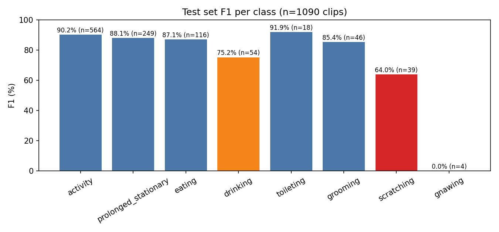

## 背景与目标

动作识别交付目标是闭集行为在留出子集上 top-1 ≥ 75%、区间级漏检 ≤ 10%。上一版基线（clipv9-b）在 Tiny 教师框渲染的片段上达到 85.75%，漏检 14.25% 未达标，弱类集中在 scratching（56.4%）与 drinking（68.3%）。教师已换成覆盖更全的 GroundingDINO-Base，因此需要看：把逐帧框和裁剪画面整体换成 Base 之后，动作模型的留出表现是否随之变化。

## 当前问题

历史片段是 Tiny 教师框渲染的，直接拿旧片段重训只会复现 85.75%，回答不了「换教师有没有用」。而要在新裁剪上训练，必须先重跑跟踪、重建逐帧框、重渲染片段——这条链路此前没有以 Base 数据完整跑过。另外片段划分仍是旧的 day-map，不是 1.20 的只读共享 split，所以本轮无法给出与新 split 口径一致的结论。

## 实验设计

链路固定：Base 检测缓存（2,723 份，stride 5）→ `track_pet_targets.py` 重跑跟踪（2,723 个 track）→ `build_clip_boxes.py` 把 `slices_v8` 的 7,554 条片段与轨迹对齐（6,959 条有逐帧框，595 条无轨迹点保留为无框、不伪造）→ `render_clip_windows.py` 渲染 60 帧 / 256×256 / crf 23（6,954 个 mp4，1,421 秒）→ `export_clip_annotations.py` 生成标注（train 4,157 / val 1,712 / test 1,090）。训练用 `configs/cat_clip_v9b_videomaev2_b.py`：16 帧、间隔 3、256→224、十类、有效 batch 16（micro 4 × 累积 4）、20 轮。测试集只跑一次，取验证 macro-F1 最优的 `epoch_10`。

## 结果与分析

训练 20 轮跑满，rc=0，3,112 秒（约 52 分钟）。第 20 轮验证 top1 83.12%、macro-F1 53.00%、balanced 54.16%——与历史 v9 的 83.28% / 50.55% / 48.87% 相比，top1 基本持平而 macro-F1 与 balanced 明显上升，说明变化主要发生在弱类而不是整体判别力。

冻结测试集（1,090 条，`best_macro_f1_epoch_10.pth`）：top1 87.43%、macro-F1 58.18%、balanced 57.08%。逐类 F1：activity 90.16（564 条）、prolonged_stationary 88.06（249）、eating 87.07（116）、toileting 91.89（18）、grooming 85.37（46）、drinking 75.25（54）、scratching 64.00（39）、gnawing 0.00（4）；fall 与 seizure 无样本。

必须一起读的三条限制：① 划分仍是旧 day-map，且片段数从 7,350 降到 6,959（Base 轨迹覆盖略低），测试集从 1,130 降到 1,090，因此 +1.68 pp 的 top1 不能全部归因于换教师；② gnawing 只有 4 条样本、fall/seizure 为 0，它们的数字没有意义；③ 渲染有少量失败（`decode_stop@51/58`，源尾部解码提前结束），这些片段没有进入训练。

## 结论与下一步

这一版可以作为新的动作识别基线：弱类改善是最有价值的信号，scratching 从历史 56.4% 召回升到 61.5%，但仍是第二弱类，离「漏检 ≤ 10%」还差得远。

下一步按依赖：（1）把片段划分切到 1.20 的只读共享 split（5.12），拿到与新口径一致的数字；（2）补 scratching / drinking 的分层分析，这两类决定漏检目标；（3）用户裁定是否用这版替换历史基线，替换前不宣称漏检目标达成。

## 附录：配置与完整数据

### 环境与配置

- 模型: VideoMAEv2-B（`checkpoints/videomaev2-base/videomaev2-base_pretrained.pth` 起步），选 best_macro_f1_epoch_10.pth 做冻结测试
- 数据集: Base 教师重建片段：6,959 条片段 / 6,954 个 mp4；train 4,157 / val 1,712 / test 1,090
- 配置: 16 帧、间隔 3、256→224、十类、micro-batch 4 × 累积 4、num_workers 6、20 轮
- 运行时间戳: 2026-11-12T13:17Z 启动，2026-11-12T14:09Z 结束（3,112 秒）
- 执行入口: models/mmaction2/tools/train.py configs/cat_clip_v9b_videomaev2_b.py（cwd 为含 checkpoints/ 的仓库根，PYTHONPATH 指向含 lib/ 的工作区，经 remote-ops 守卫）

### 局限与边界

（缺失：局限与边界未提供，待补充。）

### 来源与核查

- run 产物：results/cat_clip_v9/videomaev2_b_base/test_metrics.json
- 详细来源见 manifest 各条目的 source 字段；单位、样本量与局限见 manifest 的 metrics 条目。
- 指标与趋势见 metrics.json（series 折线 + tables 指标表）。
