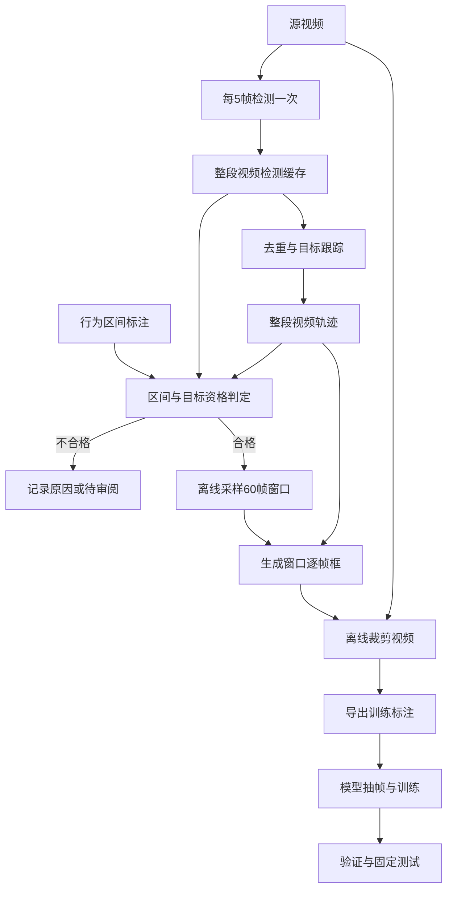

## 1. 设计范围与阅读方式

本设计说明如何把源视频、动物检测与行为标注区间组合成可训练的视频片段。检测结果按源视频保存，行为区间引用检测和轨迹结果，训练只读取离线裁好的片段。

动机见 [proposal.md](proposal.md)。本文区分三种状态：**已定**表示用户确认的方向；**已有实现**表示代码中存在对应逻辑；**拟整理**表示目标布局或方案，尚不代表已经迁移、验证或获用户审定。实施进度仍以 [tasks.md](tasks.md) 和 [evidence.md](evidence.md) 为准。

### 1.1 Goals / Non-Goals

目标是讲清每个组件的目的、输入输出和交接方式，并提供代码归属映射。当前主路径使用标签归属明确的单宠物素材，保留后续按轨迹处理多宠物素材的能力。

本次文档修订不执行检测、渲染、训练或代码搬迁，记录已定检测粒度并维持现有训练配方。存在性检测和线上动作定位不属于这条离线数据准备流程，身份向量、行为发现、背景移除也不是前置条件。

### 1.2 术语

- 源视频：原始完整视频，也是检测和跟踪的处理单位。
- 检测锚点：实际调用检测模型的源视频帧。
- 轨迹：同一视频内被关联为同一目标的一组框，以 `track_id` 标识。
- 行为区间：人工标注的源视频起止位置与动作类别，时长不固定。
- 训练片段：从合格区间选取并离线裁剪的定长视频窗口。
- 训练抽样：模型读取训练片段时，从中选择输入帧的过程。

## 2. 整体流程

源视频进入检测和跟踪；行为标注提供动作与时间范围。两路信息在区间处理时合并。检测可以在行为标注前执行，也可以在标注后执行，但必须在依赖它的区间筛选和裁剪前完成。

下图表示目标数据流，具体实现差距见第 10 章。图中的依赖关系不代表任务已经获得并行执行许可。



检测回答画面中有哪些猫狗、框在哪里。跟踪关联前后目标；区间处理决定动作标签和哪些窗口可用；渲染生成模型实际读取的视频。GroundingDINO 与跟踪器均不负责识别 drinking、scratching 等动作。

## 3. 检测设计

### 3.1 功能与模型

检测输入为源视频和检测配置，输出为整段视频的抽样帧候选框。每个实际检测帧保留帧号、候选框、物种与置信度；没有检出目标时也要保留空记录。

当前模型是 GroundingDINO-tiny，后续可选择 GroundingDINO-base 或自训 YOLO。tiny 与 base 共用 `petlib/detection/grounding_dino.py` 的模型加载、预处理、推理和后处理代码，通过模型目录加载各自的配置与权重。是否可用以及效果如何，仍需在对应模型上验证，不能由共享代码推断。

已有接口是 `petlib/detection/base.py` 中的 `Detector.detect(img_bgr, classes) -> list[Detection]`。本流水线检测猫、狗，输入为单帧 BGR 图像；行为标签不进入检测提示词。不同框架实现同一接口，未使用 YOLO 前不需要建立空适配器。

### 3.2 检测范围与时间位置

**已定：每个源视频从第 0 帧开始，每 5 帧检测一次，处理到视频结束。** 检测帧号为 `0、5、10、15……`，以源视频开头为固定起点，不因行为区间的起点而重新计数。

15 fps 视频对应每秒 3 次检测。视频 fps 改变时，每秒检测次数为 `fps / 5`；读取源视频属性，不应把所有视频都默认为 15 fps。当前处理集合为全部带标注视频，来源应是原始标注，而不是已经过滤过的旧训练索引。

> **选择与理由：整视频稀疏检测**
>
> 每 5 帧一次由用户确认。整视频结果可被多个区间复用，修改动作标签或区间边界不需要重跑检测。逐帧检测能提供更多观测，但推理次数更多，本轮不采用；只检测各个区间会导致重复推理，并使区间边界附近缺少可复用观测。
>
> 中间帧仍需估计框，稀疏检测不能保证覆盖快速运动。未检测帧不能记成检测失败，也不能记成模型实际观测。

### 3.3 保存粒度与目录

**拟整理：产物统一放在 `results/cat_pipeline/` 下，按检测批次分目录，一个源视频一份结果。** 可读标签表达模型型号和步长，tiny 与 base 的结果互不覆盖。

```text
results/cat_pipeline/
  videos.jsonl
  detections/
    gdino-tiny-s5/
      manifest.json
      <video_key>.json
    gdino-base-s5/                 # 使用base后才生成
      manifest.json
      <video_key>.json
  tracks/
    <tracking_run>/
      manifest.json
      <video_key>.track.json
  slices/
    <dataset_version>/
      intervals.jsonl
      pending_multi_pet.jsonl
      clips.jsonl
  clips/
    <dataset_version>/
      train/*.mp4
      val/*.mp4
      test/*.mp4
datasets/
  <dataset_version>/
    train.jsonl
    val.jsonl
    test.jsonl
    classes.json
```

`video_key` 表示唯一源视频标识，文件内还需记录源视频路径。现有缓存使用文件 stem；是否存在重名、如何映射，由清单整理时核对，不能仅凭文件名相同就关联。上述目录是目标布局，现有产物仍在第 9 章列出的路径。

每批的 manifest 拟记录检测器实现族、型号、实际权重与配置、类别、阈值和步长。目录名用于阅读与选择；权重 SHA-256 用于核对具体权重文件及缓存复用，不用它代替 tiny/base 的可读名称，也不用它选择行为区间。

**已有实现：** 每个视频缓存记录源文件哈希、检测指纹、视频属性、解码帧数和锚点结果。复用前校验源视频和配置；变更权重或推理参数时，不能把旧结果当成新结果。不同配置应使用独立批次，不能仅因目录名相同而覆盖。

当前缓存每 5 帧只有一次观测。若未来改变步长，需要的帧不在旧缓存中，就必须补推理；不能把稀疏缓存说成可直接重采样的逐帧结果。

## 4. 跟踪与检测的交接

跟踪读取整段视频的检测缓存，按帧号关联目标并输出轨迹。复用 `petlib/tracking/` 的 IoS 嵌套框去重、OC-SORT 关联和稳定性规则，不新增一套最高分选框规则。

已选方向是单流关联，物种作为轨迹元数据；轨迹级时序合并保持关闭。每条轨迹包含 `track_id`、物种、源视频帧号和框，同时保留检测来源与跟踪参数。轨迹标识只在该源视频和对应跟踪批次内有效，不代表跨视频身份。

检测和跟踪按源视频处理一次，可供该视频的多个行为区间复用。不同检测批次对应各自的跟踪结果，后续不能将 tiny 的检测与 base 的轨迹混用。

跟踪只提供目标关联。若区间中有两只动物，必须另外确认动作标签属于谁；同一标签不能直接分给两条轨迹。

## 5. 行为区间与检测结果的协作

### 5.1 输入与关联方式

区间处理需要四类输入：源视频标识、标注起止位置与动作、指定检测批次、对应的跟踪批次。它读取明确指定的结果，不能自动选择目录中最新的一份。

区间清单当前使用 `video`、`start_frame`、`end_frame`、`label` 等字段。如果上游给出秒数，应根据该视频的时间与帧号约定转换。实现前必须核对索引起点与端点规则，不能把检测的零起帧号直接等同于训练标注的一起帧号。

动作标签由标注提供。例如某段标为 drinking，检测结果仅用于确定该时段内动物的位置和可用性。改成 eating 不会改变已有检测框。

### 5.2 示例：截取区间与边界观测

假设源视频为 15 fps，用零起帧号、左闭右开的时间范围作说明：`[10秒, 18秒)` 对应第 `150-269` 帧。检测缓存中这一范围的实际观测为 `150、155……265`；该示例不规定仓库文件的端点格式。

后续根据指定轨迹读取区间内的框。若区间从第 152 帧开始，为估计其位置，可以读取同一轨迹在第 150 和 155 帧的观测。最终生成的窗口只输出窗口内的帧，边界辅助观测不意味着把区间外画面纳入样本。

因此，按区间取结果需要区分两组数据：用于资格统计的区间内实际观测，以及用于边界插值的相邻轨迹点。不能把所有区间外观测提前丢掉，也不能用辅助点抬高区间内的检测覆盖率。

### 5.3 资格与标签归属

目标判定单位是 **`(区间, track_id)`**，各轨迹独立判断覆盖与缺口。一条轨迹不合格，不应导致同区间另一条轨迹自动被淘汰。该规则与当前只选择覆盖最多轨迹的实现有差距，见第 10 章。

当前先使用标签归属明确的单宠物区间。多宠物区间记录为待审阅，确认动作与目标的对应关系后再纳入，不能把 tracking 成功当成标签归属已解决。

资格处理还包括闭集标签映射、短区间排除、检测覆盖、split 分配与重叠仲裁。每个输入区间均需保留去向及原因，避免只有成功片段、无法核对损失来源。

## 6. 训练片段与逐帧框

### 6.1 从不定长区间采定长窗口

**片段长度为 60 帧，15 fps 下约 4 秒。** 区间时长不固定，而训练片段是从合格区间中离线选出的窗口，两者不是同一个概念。

保留既定采样规则：固定种子 `seed=0`，分层随机选择起点，每区间最多 4 条片段；不做滑窗穷举，不在每轮训练重新切片。只对 activity 执行类别上限，下采样上限为最大非 activity 类的 3 倍，不删除同视频的其它行为样本。

短于 1 秒的标注排除。1-4 秒的标注尝试使用真实相邻帧扩展到一个窗口，需受视频及相邻标注边界约束；无法扩展时记录原因。扩展后仍需确认目标覆盖，不能因凑足帧数就认定合格。

片段清单需能追溯源区间、源视频起止位置、动作、物种、轨迹、split、是否外延及检测和跟踪来源。划分沿用固定 day map，同源视频不能跨 train、val、test。

### 6.2 从轨迹生成逐帧框

每个窗口需要一条与视频帧对应的框序列。使用同一轨迹相邻观测的框做线性插值，现有实现再进行 5 帧滑动平均。估计框与模型实际检出的框应能区分。

例如第 150 与 155 帧有观测，可以估计第 151-154 帧的位置。检测返回空结果表示该锚点未检出动物，只有确认画面中存在动物时才能称为漏检。是否允许跨过目标观测缺口，必须按资格规则处理，不能与正常的 4 个未检测中间帧等同。

现有代码会沿用轨迹端点，也会跨缺口插值。可接受的边缘延伸和缺口范围尚需核对，不能写成已验证的处理规则。缺少可用框时不得悄悄改用整帧来生成看似合格的训练样本。

### 6.3 离线裁剪与标注导出

渲染器读取源视频窗口及逐帧框，每帧跟随目标裁剪，保持画面比例并得到方形画布，越界位置补边，再缩放到 256×256，编码为独立 mp4。这样模型直接读取成品视频，无需在训练时运行检测或实时裁剪。

训练标注中的视频路径指向该片段文件，帧位置使用片段内部编号；源视频范围继续保留在来源清单中。导出前需确认片段是完整可用文件，文件存在本身不等于渲染成功。

## 7. 训练与评测

现有 `configs/cat_clipv9_videomaev2_b.py` 使用 VideoMAEv2-B 十类分类。每次读取一个片段，`SampleFrames(clip_len=16, frame_interval=3)` 从中取 16 帧；训练使用随机空间裁剪，评测使用中心裁剪，模型空间输入为 224×224。

**训练间隔 3 是模型抽帧步长。** 以零起片段帧号说明，起点为 `s` 时，抽取 `s、s+3……s+45`。首尾相差 45 个帧间隔，15 fps 下相差 3 秒；实际起点由抽样器决定，不固定为片段开头。

检测步长与训练抽帧步长不必相同。模型读取的是已经逐帧裁好的视频，改变训练间隔不能自动提高裁剪框质量。即使两者都设为 5，也还取决于源窗口起点和模型抽样起点，平滑后框也可能不同于原观测框；不能据此宣称免插值。

本轮维持现有片段长度和训练配方，不要求用户在 60 帧与 80 帧方案之间立即选择。是否增加时间跨度应另行给出验证设计和收益证据。

评测区分片段分类准确率、逐类召回和事件级漏检。当前流程消费给定行为区间，不能测出未知动作的定位能力。`1-top1` 是分类错误比例，不能据此声称已测得端到端事件漏检；可用区间比例与片段准确率的乘积也不是实测区间准确率。

## 8. 代码目录与职责映射

**已定职责方向：`petlib/` 放可导入的处理能力，`scripts/` 放命令行参数与编排调用。** 下表是逐文件的拟整理映射，用户尚需审定具体迁移位置；列入表中不表示已实施，也不要求立即拆出所有文件。

| 能力 | 当前代码 | 拟整理位置 | 状态与边界 |
|---|---|---|---|
| 单帧检测接口与结果结构 | `petlib/detection/base.py`、`petlib/schemas.py` | 原位置 | 已有，复用 |
| GDINO 模型加载与单帧推理 | `petlib/detection/grounding_dino.py` | 原位置 | tiny/base 共用，不按型号复制代码 |
| 视频抽样检测 | `scripts/prepare_cat_crop_experiment.py::detect_video` | `petlib/detection/anchors.py` | 待迁移，只处理源视频抽样观测 |
| 检测缓存与复用校验 | 同脚本的缓存函数 | `petlib/detection/cache.py` | 待迁移，管理检测结果读写 |
| 模型与推理配置身份 | 同脚本的指纹函数 | `petlib/detection/fingerprint.py` | 待迁移，供复用与追溯使用 |
| 视频清单入口 | `scripts/build_video_manifest.py` | 入口保留 | 原始标注提供视频集合，旧索引仅提供关联信息 |
| 目标去重与跟踪 | `petlib/tracking/`、`scripts/track_pet_targets.py` | 能力保留在 `petlib/tracking/` | 入口只做编排，复用已有规则 |
| 区间资格、外延与窗口选择 | `scripts/build_cat_dataset_slices.py` | `petlib/datasets/cat_selection.py` | 待迁移，接收区间及明确指定的检测/轨迹来源 |
| 轨迹到窗口逐帧框 | `scripts/build_clip_boxes.py` | `petlib/datasets/clip_boxes.py` | 待迁移，与原始检测结果分开 |
| 片段裁剪与编码 | `scripts/render_clip_windows.py` | `petlib/render/clips.py` | 待迁移，训练主路径 |
| 整段视频渲染 | `scripts/prepare_cat_crop_experiment.py` 的渲染逻辑 | `petlib/render/frames.py` | 待审定，仅审阅/对照，不是训练前置 |
| 裁剪几何与视频编码基础能力 | `petlib/datasets/cat_crop.py`、`petlib/videowriter.py` | 原位置 | 复用，具体重复逻辑迁移前核对 |
| 训练标注导出 | `scripts/export_clip_annotations.py` | `petlib/datasets/annotation_export.py` | 待迁移，保留 CLI 入口 |
| 数据集读取 | `petlib/datasets/cat_intervals.py` | 原位置 | 与片段训练配置配合 |
| 指标 | 同文件的 `CatIntervalMetric` | `petlib/metrics/cat_interval.py` | 拟分离，不在文档修订中实施 |
| 单片段推理 | `scripts/infer_single_clip.py` | `petlib/inference/recognizer.py` | 待审定；先核对与正式预处理的一致性 |
| 旧检测与批处理入口 | `scripts/pet_detect_track.py`、`scripts/pet_multi_detect.py`、`scripts/pet_batch_run.py` | 候选 `scripts/legacy/` | 先核对调用方与仍需能力，未经确认不搬移 |

CLI 名称暂保留。迁移先保持行为，并比较同一小输入下的有效内容；带生成时间的 JSON 不能仅用整文件哈希判定行为是否相同。需要纠正的行为另外记录、讨论，不混在目录搬迁中静默修复。

## 9. Context：已有实现与证据入口

下列路径用于核对当前代码和产物，不代表第 3 章的目标布局已落地。本轮只读代码和既有证据，未远程复核媒体完整性或重新计算实验指标。

| 对象 | 证据入口 | 能说明的事实与边界 |
|---|---|---|
| 整视频检测 | `scripts/prepare_cat_crop_experiment.py::detect_video` | 从零起帧号按步长推理，保存候选与指纹；CLI 默认步长仍为 10，运行时需显式传 5 |
| 检测模型与接口 | `petlib/detection/{base,grounding_dino}.py` | 已有模型目录参数与统一单帧接口；不证明 base 已完成验证 |
| 检测产物 | `results/cat_crop_classification/gdino-crop-20261103a/assets/full_run/detections/` | 历史记录覆盖 2,573 个带标注视频，详见 evidence；产物位于 pet |
| 统一视频清单 | `scripts/build_video_manifest.py`、`results/cat_pipeline/videos.jsonl` | evidence 记录 2,573 行；检测入口尚未改为只读该清单 |
| 跟踪 | `petlib/tracking/anchors.py`、`scripts/track_pet_targets.py` | 读取整视频候选并输出轨迹；CLI 默认仍为 `species_split`，单流需显式传参 |
| 区间筛选与采样 | `scripts/build_cat_dataset_slices.py` | 当前先按区间判断多宠物/覆盖，再仲裁、外延、采样；不是完整的逐轨迹独立判定 |
| 逐帧框 | `scripts/build_clip_boxes.py` | 当前选择窗口内观测最多的轨迹，并使用整轨迹点插值、端点保持和 5 帧平滑 |
| 离线片段与训练配置 | `scripts/render_clip_windows.py`、`configs/cat_clipv9_videomaev2_b.py` | 已有逐帧框裁剪入口，训练视频根为 `results/cat_clip_v9/assets/clips` |
| 训练与评测记录 | `management/experiments/cat-clip-training/20261107-clipv9-b/` | 记录已有基线；报告中的可用率、片段数与漏检口径仍需审计，不在本设计重复定案 |
| 历史规则与实验 | `openspec/changes/archive/`、[evidence.md](evidence.md) | 保留旧设计、实验细节和曾撤回的判断，历史勾选不替代代码或产物证明 |

## 10. Risks / Trade-offs 与实施边界

稀疏检测和插值可能无法跟上快速运动，跟踪也可能持续关联画面上的动物图案。低置信度、面积小或运动少都不能单独证明是假目标，不能未经审阅就新增过滤规则。

帧号存在明确的实现疑点：检测从零开始，渲染器使用 `start - 1` seek，导出训练标注使用一起编号。需要核对它们是否正确换算；本设计不声称已经发现或修复具体偏移。

现有渲染器遇到空框会缩放整帧，导出器在片段模式下主要判断文件是否存在。这与不静默回落、只接收完整成品的方向有差距；应先记录并按批准任务处理，不在文档修订时改代码。

### 10.1 Migration Plan

先审定本设计中的具体路径映射，再按获批任务把可复用能力迁入 `petlib/`，CLI 保留。检测结果及训练索引使用新版本输出，保留旧目录和索引用于回退与对照；未确认来源的旧缓存不强行归并。

当前任务队列尚有设计冲突：检测目录任务仍写 `assets/`，检测器泛化任务仍含空 YOLO 适配器与稀疏缓存直接重采样假设，采样对齐任务仍含加密检测与必然对齐的假设。此外，第 1 节的实施任务排在第 2 节目录审定之前。**这些任务不能据旧文字继续实施。** tasks 的增删、改写或重排须先向用户给出方案，获确认后再更新；本轮保留编号、勾选和证据。

## 11. Open Questions

以下问题由用户与实施者进一步讨论，未确认的建议不自动成为任务：

- 用户审定第 8 章的具体文件划分、旧入口处理范围，以及第 3 章的目标目录标签。
- 实施者核对源标注、检测、片段与训练标注的帧号起点、端点规则及真实媒体帧数，再提交是否需要修复的证据。
- 用户与实施者核对可接受的轨迹缺口、边缘延伸规则，明确现有端点保持是否适用于当前问题。
- 用户确认多宠物动作归属标注的执行安排；逐轨迹资格判定不能替代人工标签归属。
- 用户与实施者审计实际成功片段、失败残留、唯一案例匹配和区间可用率；历史汇总数字不能替代这项核对。
- 后续召回改进仍可讨论 activity 边界、输入分辨率、时间跨度、运动信息及验证集上的决策取舍。它们是待验证假设，不能以重复查看固定测试集来选择方案。
- gnawing、fall、seizure 的样本支持不足；是否补充标注与数据由用户决定。
