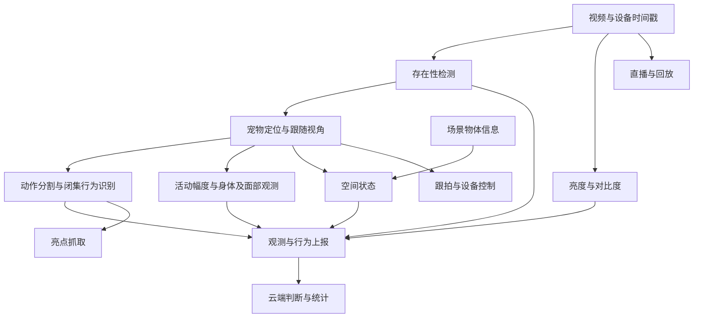

# Design: 完整管线与端云交付

## Context

交付目标见 proposal。已归档的多类别检测只验证了示例上的猫与家具检测及简单空间规则；当前没有据此证明多猫身份连续、复杂空间状态或开发板集成完成。旧计划中的身份/动作向量和无监督行为发现已搁置，不作为当前设计前置。

## Goals / Non-Goals

当前设计优先存在性检测、定位、动作分割、闭集行为识别、空间状态、观测指标与端云功能。背景移除和新增 SORT 等关联器后置研究。当前不推进身份/动作解耦编码器、行为簇发现、开放集新行为发现或异常行为研究。

## Decisions

### 主流程

本图表示功能分工，不规定所有计算都在开发板上，也不代表已完成集成。无猫和不可测状态同样需要上报；亮度和对比度不受无猫早退影响。跟拍需要定位反馈，与 SORT 是否启用分别设计。

### 存在性检测

训练与运行分开画图。教师 GroundingDINO 生成候选标签，人工核验尤其检查负样本和教师分歧，再训练独立小模型；测试集独立人工确认。运行时像素变化用于调度小模型，保留初始化和定期重检，不能把静止猫判为离场。实验比较纯小模型与像素调度的漏检、调用成本和发现延迟。

### 定位与空间状态

复用抽样检测、插值、平滑和裁剪作为起点。分别核查多类别检测、多实例检测、多猫关联，不能合并宣称完成。现有猫框底边中点落入家具框的规则只能作为空间状态基线；家具框重叠、透视和遮挡需人工真值验证，无猫时保留旧状态不能充当当前真实状态。代码核查发现：pet_detect_track.py 对每个抽样帧仅保留最高分猫框，再插值和平滑；这不能保证多猫连续关联。空间规则也有版本差异：pet_multi_detect.py 使用底边中点，pet_detect_track.py 使用猫框底部三分之一区域与家具框的重叠比例（至少 50%），家具信息按抽样结果复用。两种规则均缺少独立关系准确率评测。场景物体信息如何产生与更新仍需实验审定，SAM 背景记忆只是候选。

### 动作分割与闭集识别

输入带时间戳的原视频/裁剪及现有模型特征，输出动作区间、闭集类别及置信信息。当前按窗口分类后聚合的路线设计；先分段后分类及现成 TAS 联合预测留待后续考察。离线整段与有限后视分块均可，不强制因果；记录后视范围、块边界处理、EOF、结果修订和延迟。不得依赖自研身份/动作向量或行为簇。

仓库已收集 MS-TCN、ASFormer、DiffAct、CTE、TW-FINCH、TAEC、ASAL 名单，尚未完成猫场景选型。逐一核查监督需求、特征、权重、许可与动作顺序/重复假设，之后确定实验。候选原理来源：[MS-TCN](https://arxiv.org/abs/1903.01945)、[ASFormer](https://arxiv.org/abs/2110.08568)、[DiffAct](https://arxiv.org/abs/2303.17959)、[TAEC](https://arxiv.org/abs/2303.05166)、[TW-FINCH](https://arxiv.org/abs/2103.11264)。

### 观测指标

需分别提取亮度、对比度、活动幅度、身体画面面积占比及时长、面部暴露面积占比及时长和行为识别信息。每项写明输入、方法、单位、统计窗口、有效性与置信信息。身体框不是身体掩码，脸框也不等于实际暴露面积；方法选择和面积分母尚未审定，不能提前声称可精确提取。可测、缺失、遮挡和无猫不能都编码为零。

### 端云集成

逐项覆盖行为上报、统计、直播、跟拍、设备控制、回放与亮点抓取。先盘点开发板与云端现有能力，再明确计算位置、协议、时间同步、资源预算及真实设备验收。闭集分类模型成绩与导出后端侧成绩分别记录；设备跟拍需要定位、目标选择、控制反馈与丢失处理，不等同于离线居中裁剪。

### 实验与验收

准确率 75% 以上、漏检率 10% 以下是交付目标。先审定评测单位、类别汇总、事件匹配与分母，再冻结独立测试集。分别报告存在性漏检、定位漏检、分割漏段及端到端行为漏检，防止用局部成绩代替最终成绩。每项实验必须给出对照、固定变量、数据、命令前置、资源、指标、通过标准、产物与后续分支。

## 架构文档结构

正文重写须按单篇文档 change 审定结构后实施；本总 change 负责范围与联合验收。组件名全部用全名，不使用字母加数字的层号。

### 目标与总图

说明闭集目标、端云交付、当前范围与可选增强；总图显示各输出的汇合和旁路。

### 数据与评测

说明视频、时间轴、闭集类别、标注、数据划分及两个交付指标的计算规则。

### 存在性检测

分别展示训练 Mermaid 图与像素检查/小模型确认的运行 Mermaid 图。

### 定位与跟随视角

展示检测、插值、平滑与裁剪内部图；说明多猫限制和后置关联器。

### 行为识别与动作分割

展示闭集模型训练、窗口分类及时间聚合的整体流程，解释段边界、待确认参数、离线与有限后视处理，以及端侧复核。

### 空间状态

展示宠物与场景物体输入、关系判定、时序确认及不可测状态图。

### 观测指标

展示亮度、对比度、活动、身体及面部面积与时长的提取和统计图。

### 端云集成

展示上报、云端判断、统计、直播、跟拍、控制、回放、亮点抓取的数据和控制路径。

### 实验与排程

按组件给出完整执行路径及 Mermaid 依赖图，说明可并行 worktree 的接口、资源与集成验收。

## Risks / Trade-offs

- 示例检测效果不能代表总体准确率：补充独立标注与跨视频评测。
- 暂不增加关联器时，多猫目标选择仍可能失败：明确支持范围，标记歧义，不伪造身份连续。
- 分类准确率不能反映漏掉的事件：独立统计端到端漏检及阶段误差。
- 面部与身体面积定义影响实现与标注成本：先审定口径，再选方法。
- 研究旧依赖可能阻塞交付：从活动子 change 中解除相关前置，保持研究搁置。

## Migration Plan

先完成只读盘点、验收口径与子 change 修订，经审核后实施；所有代码本地提交同步，远程只执行已批准流程。新实验产物独立版本，不覆盖已有模型与数据；集成变更保留上一版接口和部署的回滚路径，具体命令在实施子计划中确定。

## 三组件讨论顺序与初步研究

存在性检测、动作分割、空间状态优先完成设计讨论。先解释全景，由用户逐步决定输出语义、处理形式、模型、参数与验收口径；本节候选不代表已选定实现，不启动实验。

动作分割初查覆盖代表性方法而非完整最新排名：MS-TCN/ASFormer 的特征序列到逐时刻类别预测、ASRF 的类别与边界双分支、DiffAct 的条件去噪、TW-FINCH 的无监督聚类，以及 ActionFormer 的事件区间定位。官方来源：[ASRF](https://yiskw713.github.io/asrf/)、[ActionFormer](https://arxiv.org/abs/2202.07925)，其余来源见前文。

可讨论路线包括复用闭集分类输出做时序聚合、训练监督 TAS、在只需目标事件区间时使用时序动作定位。选择前须先由用户确认是完整行为时间轴还是目标事件列表，再核查现有区间标注能否转成监督真值；区间未标注的空白不能直接视为负类。监督模型需要猫场景数据，现成人类任务代码与权重不等于可直接识别宠物。有限后视改造需独立验证，不由离线代码的可用性推出在线可用。

存在性检测需先讨论漏猫与调用成本的权衡、静止猫与初始化；空间状态需先讨论关系词表、相机是否移动以及无法测量时如何表达。具体网络、SAM、阈值、窗口与持续时间均不在本轮决定。
