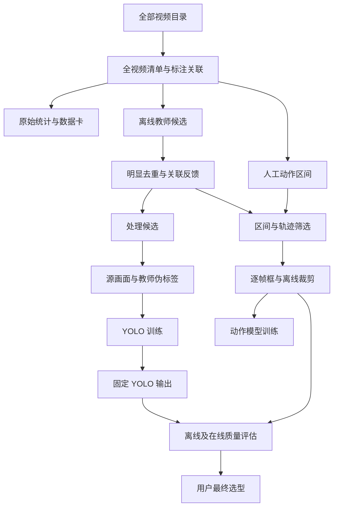

# 宠物视频共享数据与训练流程

## 背景与范围

本设计把完整视频与教师检测作为两路共享前置，再分别准备检测器伪标签及动作模型所需轨迹。本轮只落盘方案，不运行检测、训练或搬迁代码；两个 GDINO 来源任务已按映射整合并作为 superseded 归档；本 change 的 delta 是待审的未来合同，不表示能力已交付。存在性检测、动作定位、身份向量、行为发现及背景移除不作为这里的前置。

## 流程概览

以下是目标数据流，并非已有实现。教师结果及共同划分可复用于两路；YOLO 数据准备不依赖动作轨迹或区间物种统计。时序重复判断尚未裁定，依赖处理候选的两路都须等待，不用临时规则绕过。



## 1. 数据准备

首先从全部视频目录建立完整视频清单，再关联人工行为区间，而不是从旧训练索引或标注反推视频全集。上轮只读统计 pet 有 2,737 个视频，其中 2,573 有标注、164 无标注，共 3,927 区间；本轮未复算。旧索引只含 2,144 视频，不可作为全集。清单需记录唯一视频标识、源路径、视频属性、标注关联与划分；stem 可能重名，关联前须核实。无标注不等于负样本。

训练前分别统计源视频时长分布和行为区间时长分布，并统计各类原始区间数、涉及的源视频数及累计区间时长。另须统计每个视频的标注时间并集、未标注时间，以及同类与异类区间重叠。累计原始标注时长按区间相加，重叠部分可能重复计入；它不能冒充去重后的并集覆盖时长，未标注时间也不能当背景真值。源标注、检测和导出各自的帧号起点、端点及时间换算须在实施前核对。

两条训练路线共用源视频隔离边界，包括 train、val、test 的划分与来源记录。尤其不能用动作测试视频的教师伪标签训练 YOLO，再把该 YOLO 用于端到端测试；事件日层面的关联与历史泄漏也需披露。旧 day map 仅为复用候选；最终以两路线共同获批的 split 为唯一依据，不自动沿用 YOLO 旧 80/10/10 划分或旧未分配项处理。

## 2. 教师检测

GroundingDINO-base 是离线教师候选，不预设比 tiny 更准。先在小批有代表性材料上人工核对，再由用户决定下一步；仅有教师一致性不等于真实准确率。tiny 和 base 共享 `lib/detection/grounding_dino.py`，通过配置和权重区分，不复制模型代码。每帧检测接口接收 BGR 图像和猫狗类别，动作标签不是检测提示词。

默认全视频从源视频第 0 帧开始每 5 帧检测一次，15 fps 对应 3 Hz；其他 fps 为 fps/5。也提供按区间选帧能力：选帧由调用层负责，区间模式仍筛选同一全视频相位的帧，而非在区间起点重置。检测器本身只负责单帧检测。全视频结果更易供不同区间复用，但不能因此把区间外观测计入区间内覆盖率。

所有原始候选与实际检测的空结果完整保存；每个结果记录源视频、帧号、类别、置信度及教师配置。检测输出是候选框而非像素 mask；生成原始候选不需要 track_id，也不等待跟踪选型或时序去重。空框仅表示该帧未检出，不证明画面无动物；未检测帧也不是空检测。原视频哈希、权重和配置指纹用于追溯并阻止错误复用；缺少所需帧的稀疏缓存不能直接重采样出未曾检测的结果。

## 3. 重复框与跟踪

原始候选不覆盖，另存去重结果与轨迹，并记录处理前后框、来源和理由。教师候选用于学生伪标签及动作数据准备时，以及在线 YOLO 推理时，都需要重复框处理，防止一只动物被当作两个目标；动作模型训练循环不因此重新检测。先处理同帧明显重复框，再与关联反馈，重点结合既有轨迹和过去观测的位置连续性复核当前疑似重复；证据充分才合成一个目标，不确定时保留歧义以保护两只真实动物。因果部分只使用当前及过去，离线未来帧复核单独标识。已有 IoS 处理仅为基线，不能只凭一次 IoS 高删除真动物，具体阈值、窗口和融合方式待商定。上方流程图的去重候选和轨迹表示复核后的结果，不排除复核前生成初步轨迹；详见本节与[来源研究](tracking/research.md)。处理候选可供 YOLO 数据复用，但不阻塞 raw 教师检测。低置信度、小面积或少运动本身不证明是假目标，印刷图案也可能产生持续假轨迹。

跟踪能力独立放在 `lib/tracking`；已有单流 OC-SORT 是运行过的基线，不是最终选型，也不声称优于 SORT。跟踪选型读取教师缓存，轨迹推断及依轨迹生成逐帧框和裁剪须等待获批的固定候选和关联参数，而非最终胜出选型；详见本节与[来源研究](tracking/research.md)。单流关联、物种作为轨迹元数据，`track_id` 仅在对应视频和跟踪批次有效。现有轨迹级时序合并默认关闭，曾将猫砂盆与真猫错误合并，不可直接启用；具体证据见附录 B。不同 ID 须先有可接受的关联证据，不能靠插值证明它们是同一目标；同 ID 的短缺口可插值，具体可接受缺口、端点延伸及关联规则仍须确认。实测检测框与估计框必须区分。

### 组件边界、候选与评估顺序

教师 raw 独立完整保存，组件输出可追溯的 processed 候选、轨迹及逐帧估计，供伪标签和动作窗口消费；裁剪视频和数据仍由本 change 的动作路线负责。原始候选不等待本组件的任何裁定。讨论真实案例、GT、候选和规则预算后，由用户批准固定候选版本，才接入候选和共享因果处理。该版本用于产出数据和评估，不是临时 fallback、生产默认或最终胜者；最终选择在固定 YOLO 输出和裁剪产物可用后的离线、在线质量对照及报告之后。缺少在线评估输入则停止并报告，不自行检测。

已有 OC-SORT 只是运行过的基线，Hybrid-SORT 无 ReID 与 Deep OC-SORT 外观方法只是候选；不要求全算法 benchmark。低分候选已被教师缓存阈值截断，不能恢复；现有脚本未向跟踪器传源帧，外观方法所需 source image 尚有缺口。不得静默回退。离线可使用未来帧并单独标记，在线只用当前与过去，等待未来帧则披露延迟。mask 不是身份真值，track 可包含多个动作，多宠标签未分配不能复制。候选来源、证据深度和历史完整快照见 [tracking/research.md](tracking/research.md) 与 [tracking/](tracking/)。未跟踪主规格 `multi-pet-tracking` 的权威及归属仍待裁定，不覆盖该文件。

### OC-SORT 怎样跟踪

检测器先给每个检测帧提供候选框；OC-SORT 不是检测器。跟踪器根据已有轨迹的运动预测目标下一次可能出现的位置，再把当前检测框与已有轨迹匹配，以延续对应 ID。目标短时未被检测时，它可暂时保留轨迹并预测位置（coast）；预测不等于一次实测。

匹配稳定后轨迹可被确认，长期未匹配的轨迹会终止；无法匹配已有轨迹的新检测可生成新 ID。具体确认、保留和终止参数须另行核对，不在这里新增阈值。遮挡后重新出现可能得到错误关联或新 ID，OC-SORT 不保证重新识别；ID 也不代表跨视频身份。

一条轨迹可能包含多个动作，轨迹起止不是动作边界。修改原始标注只能作为待实验方向，不自动执行。多宠物关联仍未验证，关联成功也不能说明人工动作标签属于哪只动物。

## 4. 两路训练

### 4.1 YOLO 检测器

YOLO 使用源画面和教师实际检测帧的伪标签。这里主要是伪标签监督，不声称已实现特征蒸馏；插值框不是实测教师标签。保留教师指纹、原始候选、处理记录和每帧去向，便于追溯和核对过滤偏差。未标注视频或教师空框不能直接当作已确认的负样本。学生会继承教师错误，速度、教师一致性和人工真值准确率是不同问题；训练与部署还须核对许可证。

### 4.2 动作分类

动作路线以人工区间和指定 `track_id` 共同筛选，资格单位为区间与轨迹；每个输入区间保留去向与原因。标签归属不明的多宠物区间待审阅，不能复制同一标签给所有轨迹。允许使用区间外相邻轨迹点作边界插值，但不能计入区间内实际覆盖，也不能输出窗口外画面。

合格区间离线选择 60 帧窗口，每区间最多 4 条，已有规则为固定种子 0、分层随机起点，不做滑窗穷举；activity 类上限为最大非 activity 类的 3 倍。短于 1 秒排除；1–4 秒的区间尝试用真实相邻帧扩到窗口，不越视频及相邻标注边界，失败记录原因。split 必须使用两路线共同获批的划分；旧 day map 仅是候选，同视频不可跨 split。

每个窗口生成逐帧框，再从源视频离线裁剪并存为 256×256 视频；保持比例、补边，输出完整性需审计。框缺失不能静默回退整帧。标注导出需同时保留片段内部帧号、源视频范围、标签、轨迹和检测/跟踪版本。现有代码有端点保持、跨缺口插值、空框回退整帧与仅凭文件存在导出等差距，不能说这些限制已修复。

当前 VideoMAEv2-B 训练配方从片段中取 16 帧、训练步长 3，空间输入 224；检测步长 5 与之不同无需强行统一。即便步长相同，起点也不一定对齐，离线裁剪仍需逐帧框。60 帧约 4 秒（15 fps），训练采样首尾相差 45 帧间隔；其他时间跨度与分辨率只作为另行验证的候选。

## 5. 在线推理

在线只使用 YOLO 每 5 帧检测，配合因果跟踪/预测，或明确声明延迟后进行插值；再经裁剪缓冲送动作分类器。离线教师不在线运行。线上时延、跟踪失败和帧缓冲的具体契约待验证，不能把离线依赖未来帧的插值说成零延迟在线能力。分类器消费已给定窗口，不等于具备未知事件定位能力。

## 6. 存储与统计

共享不可变版本派生数据建议放在 worktree 外的 pet `~/datasets/pet_pipeline`；路径是已批准的方案，尚未物化。每次运行生成新版本并明确输入、配置和来源，不覆盖旧数据；`results` 留实验日志、指标和权重。

```text
pet_pipeline/
  inventory/               # 全视频清单及标注关联
  statistics/              # 机器可读统计
  detections/raw/          # 原始候选及空检测
  detections/processed/    # 去重结果
  tracks/                  # 按视频与批次的轨迹
  detector_datasets/       # 源画面及教师伪标签
  action_datasets/
    clips/ annotations/ provenance/
```

检测后按区间统计猫 only、狗 only、猫狗及 unknown，并区分先后出现与同时共存。该统计来自模型估计，不是人工真值；不能把空检测自动归类为无动物。原始统计完成后即提供可发现的数据卡与机器统计，并在 `AGENTS.md` 链接；检测后再追加物种统计，不等待训练或线上设计完成。本轮不修改这些文件。

## 附录 A：代码职责与迁移

正式清单、统计和处理入口及可复用能力放在 `lib`，可用 `python -m` 调用；`scripts` 主要留临时探针及检查、迁移工具。原则后续固化到 `AGENTS.md`，`repo-structure` 精简为导航，不复制巨型目录树。通用代码 `cat_selection` → `pet_selection`、`cat_crop` → `pet_crop`；重命名前检查调用方和已有行为。

| 能力 | 现位置 | 拟目标 | 状态与边界 |
|---|---|---|---|
| 全视频清单与正式入口 | `scripts/build_video_manifest.py` | `lib.datasets.video_manifest`（支持 `python -m`） | 现仅从标注出发；扩展全部视频，旧结果保留 |
| 原始与物种统计、正式入口 | 分散于现有处理脚本 | `lib`（具体模块待定） | 目标能力，物种统计依赖检测结果，不是 GT |
| 单帧检测接口与结果结构 | `lib/detection/base.py`、`lib/schemas.py` | 原位置 | 已有接口，复用 |
| GDINO 模型加载与单帧推理 | `lib/detection/grounding_dino.py` | 原位置 | tiny/base 共用；base 效果尚未验证 |
| 抽帧检测与正式入口 | `scripts/prepare_cat_crop_experiment.py::detect_video` | 候选 `lib/detection/anchors.py` | 待迁移；区间选帧由调用层负责 |
| 检测缓存与复用校验 | 同脚本 `load_reusable_detection` 等 | 候选 `lib/detection/cache.py` | 待迁移；保留原始候选和空检测 |
| 模型与推理指纹 | 同脚本 `model_fingerprint`、`detection_fingerprint_for_args` | 候选 `lib/detection/fingerprint.py` | 待迁移；来源不匹配不能复用 |
| 去重与跟踪、正式入口 | `lib/tracking/`、`scripts/track_pet_targets.py` | `lib/tracking/`，正式入口具体模块待定 | 已有 OC-SORT；时序重复判断待商定 |
| 区间资格与窗口选择 | `scripts/build_cat_dataset_slices.py` | `lib/datasets/pet_selection.py` | 待迁移并通用化；按区间和轨迹判断 |
| 轨迹生成逐帧框 | `scripts/build_clip_boxes.py` | 候选 `lib/datasets/clip_boxes.py` | 待迁移；观测与估计分开 |
| 片段裁剪与编码、正式入口 | `scripts/render_clip_windows.py` | 候选 `lib/render/clips.py` | 待迁移；拒绝静默整帧回退 |
| 整视频审阅渲染 | `scripts/prepare_cat_crop_experiment.py` 渲染逻辑 | 候选 `lib/render/frames.py` | 仅审阅/对照；是否迁移待定，非训练前置 |
| 通用裁剪几何 | `lib/datasets/cat_crop.py` | `lib/datasets/pet_crop.py` | 待更名，先核对调用方和行为 |
| 视频编码基础能力 | `lib/videowriter.py` | 原位置 | 已有，复用前核对 |
| 标注导出、正式入口 | `scripts/export_clip_annotations.py` | 候选 `lib/datasets/annotation_export.py` | 待迁移；保留来源和媒体审计 |
| 数据集读取 | `lib/datasets/cat_intervals.py` | 原位置 | 已有；核对调用方及帧号规则 |
| 区间指标 | `lib/datasets/cat_intervals.py::CatIntervalMetric` | 候选 `lib/metrics/cat_interval.py` | 是否拆分待定，不作为当前前置 |
| 单片段推理 | `scripts/infer_single_clip.py` | 候选 `lib/inference/recognizer.py` | 是否迁移待定；先核对预处理 |
| 旧检测与批处理入口 | `scripts/pet_detect_track.py`、`pet_multi_detect.py`、`pet_batch_run.py` | 具体处置待定 | 先核对调用方；不预先移动或删除 |

表中目标是职责方向而非已实施路径；正式 CLI 与能力均放 `lib`，不把 scripts 薄封装当最终正式入口。迁移先保持行为，比较同一小输入的有效内容；带生成时间的 JSON 不能仅用整文件哈希判定行为一致。需要纠正的行为单独记录，不与搬迁静默混合；保留旧产物用于回退。

## 附录 B：现状、验证及风险

历史完整视频检测覆盖 2,573 个带标注视频，检测 CLI 默认仍为步长 10，跟踪 CLI 默认仍为 `species_split`；目标是每 5 帧、单流，不能把目标当现状。现有逐帧框选择窗口观测最多轨迹，并非完整逐轨迹资格处理。历史 7,350 有框片段、7,342 成功渲染等数字及实际媒体完整性仍需审计。

原始标注、检测、渲染 seek 和训练标注存在零起/一起及端点差异疑点，需实证换算，不能预称已修复。历史测试集 1,130 片段 top-1 85.75%、macro-F1 56.23% 是片段分类结果；区间级漏检口径和事件级定位应分别披露，不能将片段成绩或可用率乘积冒充实测端到端结果。

猫砂盆与真猫错误关联的记录见 `openspec/changes/archive/2026-11-08-multi-pet-sort-tracking/evidence.md` 的「轨迹级时序合并实现与实测」。其他历史来源和撤回的判断见 [evidence.md](evidence.md)、`openspec/changes/archive/` 与 `management/experiments/cat-clip-training/20261107-clipv9-b/`。旧任务 1.3.1 勾选不证明其 20 行磁盘核验已完成；旧 tasks 的路径、空适配器、重采样与步长对齐假设均与本设计冲突。用户已确认总体结构；必要规格 delta 已编写，仍待父审阅。不得为了连续进度改写历史证据；tracker-selection 已按并入方式归档，未完成不等于验收。

待共同确认：时序重复与轨迹关联/缺口规则、视频划分和未分配项、教师小批人工核对方式、多宠物标签归属及原始标注边界、规格和迁移细节。稀有类数据、activity 边界和更大分辨率等是待讨论或待实验方向，不自动加入实施。

## Open Questions

旧脚本和单片段推理迁移的具体处置、采样锚点对照及真实插值误差评估，activity 边界与是否拆分、384 分辨率、双通道输入、阈值扫描，均未获确认，不是本次必做实验。用户已确定检测 stride 5，不重新提出加密或假设相同步长必然对齐。教师人工框评测的样本和成本仍须用户确认；参见任务 2.14 和 4.13。学生消融是否开展由任务 4.10 裁定，获准后另行明确实验任务及预算。

### 原始数据卡来源披露

任务 1.10 承接已停止的 `verify-cat-dataset-provenance` 的历史来源及未知披露：历史源路径、接收快照和副本校验范围见 `openspec/changes/archive/2026-11-08-verify-cat-dataset-provenance/evidence.md`；当前源端数量/权限/一致性及旧路径报告附件的存在与哈希未知。历史路径不是当前可访问性证明；披露不等于源端复查或附件恢复。检测后物种统计追加的当前任务是 5.2。

### 今晚 raw 提取中的不可读源

运行中若源容器无法打开，保留原错误并停止，不能把空检测判为源失败。父会话裁定：记录经首帧检查确认不可读的源及其 SHA-256、大小和错误，恢复时仅排除与原清单及当前源哈希精确匹配的 ledger 项；其余视频继续原参数检测。原清单和批次索引不变，失败批状态与 ledger 保留，不宣称全部原批成功；未知模型、资源及运行错误继续 fail-fast。结果需分别统计成功、明确源失败及未处理，raw 仍未经质量验收。

### 1.3 完整目录清单实现约定

`python -m lib.datasets.video_manifest --video-root <源视频目录> --output-dir <新版本目录>` 递归枚举源目录中的 `.mp4/.avi/.mov/.mkv/.webm`（扩展名忽略大小写），不跟随目录符号链接，也不纳入符号链接文件；不读取标注、不解码或检查视频可读性。`videos.jsonl` 按相对源根目录的 POSIX 路径排序，每行 `video_id` 和 `path` 均为该相对路径，重复标识报错；同 stem 的不同相对路径不同。`manifest.json` 记录绝对源根、格式版本、行数及 JSONL 的 SHA-256。空目录或非目录报错；输出目录必须不存在，版本一经创建不覆盖。枚举是文件路径快照，不保证媒体有效或文件内容未变化；标注关联和时长统计属于后续任务。
