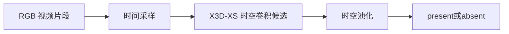

# Design: 存在性检测

## 范围与已有证据

本 change 解决存在性检测问题，覆盖整帧、指定区域与指定候选目标的 RGB 图片／视频输入。模型不做身份识别、动作分类或框回归。整帧与区域任务输出相应时刻或窗口的 present/absent 分数；候选目标任务判断指定对象是否为真实宠物，不能借用邻近宠物证明该对象为真。

规划范围已经用户确认，本次仅更新产物。后续执行以 tasks.md 的编号为顺序，跨节严格串行，未明确标注对象的任务不得并行。所有数据收集、训练与推理仍须取得 Apply 授权。

已有单帧 MobileNetV3-Small 二分类模型；教师标签测试召回 0.973、FPR 估计 0.871，不能代替独立人工验收。原生画面教师标注、小目标分辨率问题、运动统计和既有训练记录保留在 evidence.md；历史记录中的旧编号不作为当前实施顺序。

## 速度优先的模型选择

### 单帧基线

RGB 整帧 [B,3,H,W] → MobileNetV3-Small → 空间池化 → 二分类头。复用 scripts/train_gate.py 的现有骨干作为图片基线。整帧门控不依赖定位或 followcam；下游局部验证则可以接收已经生成的裁剪。两类输入分别训练评测，现有整帧 checkpoint 在局部输入上的结果只作为迁移基线。

### RGB 视频模型：X3D-XS

视频模型不复用或受限于已训图像骨干。采用已确认的 X3D-XS 作为视频基线：RGB 序列 [B,3,T,H,W] → 轻量 3D 时空卷积 → 时空池化 → 二分类头；从官方 Kinetics 视频预训练权重初始化，替换分类头。官方构造默认4帧、160空间配置，Hub示例使用182预处理，两者不可混称固定唯一输入。建议两秒clip均匀取4帧，整幅画面等比缩放加边缘填充到审定空间尺寸，避免中心裁剪漏掉边缘宠物；这种预处理变更需要实测。小目标召回与实际延迟仍需验证，不宣称全球最快。官方来源：https://github.com/facebookresearch/pytorchvideo/blob/main/pytorchvideo/models/hub/x3d.py 。整帧图片与视频初评结果见 evidence.md；局部任务另按 tasks.md 训练评测，不以整帧参数直接确定局部输入参数。

### 整帧首轮协议

本节保留已完成首轮的协议上下文，不规定后续局部任务的样本量和执行顺序。首轮执行顺序由用户明确为图片标注→图片训练和初评→视频标注→经确认的视频模型训练和初评。每阶段建议400个样本，先按源视频划分为训练280、验证60、测试60；实际正负数与昼夜分布标后报告，不宣称少量样本给出最终置信结论。两个阶段尽量使用同一批源视频与固定split，但标签语义必须分别说明。

先分层抽200个源视频，按家庭、日期、昼夜覆盖，并包含真负候选，源内每阶段最多2个样本；短视频不足时少取并补其他源，不复制样本。图片取约1/3、2/3时刻，去重后不足400补源；视频长≥6秒时，在0至L-2秒范围取1/4、3/4位置为两段2秒clip起点，互不重叠；4≤L<6秒取原四分之一位置的一段；2≤L<4秒只取居中一个2秒clip；L<2秒首轮跳过。记录实际计数，400是目标而非保证。首轮不对2737段全量切片，不密集滑窗。

每张图片仅标该时刻present/absent。视频建议“完整两秒内出现过宠物即present，整个片段没有才absent”，已获用户确认并需在页面显著显示；它不表示片段末时刻在场。训练标签仅二类，无法判断时允许跳过待复核，不强迫猜测。先训练图片再开放视频批次，两个阶段分别汇报accuracy、recall、FPR、混淆矩阵和样本数，不仅报总体准确率。

### 标注窗口

复用现有 /gate/review 页面，增加图片/视频模式。视频显示单个可播放clip、重播/进度、present/absent按钮与P/A快捷键、跳过/上一条/保存进度；同一时刻不自动播放整页视频。不要求框或行为标签。后端沿用set/items/labels协议，新增安全的视频流接口，支持浏览器范围请求；路径限制在review根目录。图片标签保存完毕才能执行第一阶段训练；视频训练等待模型确认及视频标签冻结。

## 数据提取与组织

### 源数据与已有资产

主源为 pet-final 的 datasets/cat_raw：既有审计记录 2737 段、124 天、8+ 户码，含 164 段未标注视频；这是历史盘点，实施前需重新核实可达性和清单。老家 79 段按既有记录用于跨设备/家庭测试，不混入训练。未标注和行为区间之外都不等于无宠物。

已有 results/gate/dataset_v1/manifest.csv、帧资产、教师标签和 runs/ 模型可复用，但不得默认其 split 已满足新实验。训练入口 scripts/train_gate.py；人工核验集入口 scripts/prepare_gate_review_set.py；教师标注 scripts/label_gate_native.py。已有提帧入口的注释引用可能过时，实施前必须核实实际入口，缺失则按仓库规范补齐并提交后执行。

### 统一来源清单与划分

先建立 source_manifest.csv：source_id、source_path、household、camera_id、recording_date、duration、fps、width、height、domain、split、源文件指纹。未知设备等元数据显式标缺失，不猜填。

保留现有按日期隔离协议作为主域划分候选，同时按家庭报告结果；未见家庭/设备测试单列。先冻结 source_id/date 与 split 对应关系，再切帧/片段；同源视频、连续录制及重叠时间段不可跨 split。新旧数据近重复须核查，旧 checkpoint 若接触新测试源则只能作历史参考，公平对照需从相同初始化重训。

### 单帧数据路径

原视频 → 按真实时间戳顺序解码 → 1 fps 作为既有基线抽样起点 → 保存不裁剪的 RGB 整帧 → 关联教师与人工标签。保留原生源定位，存储长边 1280 的帧只作中间资产；如分辨率标定要求更大输入须从源重取，不把放大 JPEG 当高分辨率信息。

frames.csv 字段包括 frame_id、source_id、frame_idx、timestamp_sec、path、split、domain、teacher_label、human_label、review_status。teacher 与 human 分列，冲突与 uncertain 不静默合并。单帧标签为该时刻在场，不将整片段标签复制为所有帧真值。

### 视频数据路径

同一 source_manifest → 按审定窗长/步长生成 clips.csv → 保存源时间范围及采样帧的真实时间戳 → 按需取 RGB 帧。代理 H.264 小视频用于人工观看，模型输入可使用可追溯帧缓存；不得在训练时为每个重叠窗重复随机打开 HEVC 文件。

clips.csv 包含 clip_id、source_id、start_sec、end_sec、sample_timestamps、frame_ids、proxy_path、split、domain、label_scope、teacher_label、human_label、review_status。尾部不足窗口的处理需在试标前确定；不静默补帧、跨视频拼窗或把缺帧当 absent。视频增强对同一窗口使用一致几何及颜色参数，避免伪造运动。红外画面保持三通道 RGB 编码，不人为着色。

### 标注与目录

随机代表性样本和静止、小目标、夜视、遮挡、出入画难例分开登记；训练可主动挖难例，测试另报真实比例与分层表现。教师提供弱监督，人工核验真负样本及独立测试；视频辅助标注可用于确认某个时刻，并不必然要求视频模型。先小批试标测工时与一致性，再决定数量，不预承诺 2000 段或数小时。

新资产建议置于 results/gate/dataset_v2/：source_manifest.csv、frames.csv、clips.csv、frames/、proxies/、labels/、split.json、dataset_card.md。runs/<run_id>/ 保存 config、环境、指标、预测、阈值及 checkpoint；benchmark/<run_id>/ 保存测速。所有大产物不入 Git；历史 dataset_v1 不覆盖。

## 局部图片与视频验证

### 用途与输出语义

指定区域检查回答该区域内是否存在真实宠物。候选目标验证回答指定框或轨迹所指对象是否为真实宠物。两者使用独立的标签语义、输出范围和指标；上下文中出现其他宠物，不能替候选目标提供正标签。狗粮包装、印刷图案、海报与玩偶属于非真实宠物候选，真实静止宠物属于正例。

候选素材表示尚未审核的图片或视频。审核样本表示人工确认目标关联、可判读性和标签的素材。只有审核通过且标签明确的样本才有训练准入资格；无法判断保留为待复核，关联错误或裁剪不可判读的片段不进入训练。模型返回的分数表示指定输入范围内的判断，不构成对生物活性的保证。推理证据不足时的复核状态及阈值由用户在执行前审定。

### 同轨迹局部视频生成

复用 GroundingDINO 检测框与现有 SORT 系列关联产物。SORT 是关联防线，实际适配器、配置和产物指纹写入素材元数据，本 change 不修改关联算法，也不宣称跟踪已通过所有场景验收。

在同一候选轨迹内选取两个或三个真实检测锚点，从首尾锚点间解码原始连续帧。锚点只提供时间和位置线索，中间帧不要求每帧检出。不得用重复锚点图片生成伪视频，也不得跨 track、源视频或已知身份交换位置拼接。插值框与预测框只能指导裁剪位置，不能充当真实检测或训练标签。

每个素材记录 source_id、源时间范围、轨迹标识、锚点帧与框、裁剪坐标、生成配置和用途。图片可以由同一轨迹素材抽帧产生，必须保留派生关系。疑似关联错误须标记供人工检查，人工发现不同宠物混入时拒绝该片段；同一 track ID 不能代替此检查。

> **Why & What - 局部裁剪方式**
>
> **What:** 建议先验证覆盖锚点框并保留上下文的固定区域裁剪，具体范围由用户审定。
>
> **Why:** 固定窗口保留目标相对环境的变化，便于人工核对；目标移动较远时，区域会扩大并降低有效分辨率。
>
> **Alternatives considered:** 跟随目标裁剪能保留更多目标像素，但依赖关联和框插值，窗口抖动也可能制造伪运动。
>
> **Fallback:** 若固定区域不可判读，记录失败并提交用户选择，不自动切到跟随裁剪或把失败样本标 absent。

最少锚点数、最大间隔、片段长度、上下文范围及输入尺寸由用户在采集前确认。视频收集与推理共享审定的素材生成方式，避免训练与使用时采用不同裁剪分布。

### 人工复核与训练准入

候选素材先进入独立候选清单，不进入训练加载器。人工复核人员检查片段内的对象关联、裁剪可判读性及标签，保存复核人、复核时间、结论和拒绝原因。审核时同时展示局部素材与可追溯原画面，避免因局部裁剪丢失包装文字或对象归属信息而误标。

审核通过的负例应覆盖包装、动物图案及实际误检杂物；正例覆盖静止、夜视、小目标及遮挡。移动包装仍为负例，静止真宠物仍为正例。不将 GroundingDINO 未检出、SORT 稳定轨迹、低运动量或模型置信分数直接变成人工标签。

先按源视频、连续录制及家庭／设备协议划分，再生成派生样本。同一源的整帧、局部图片和视频不得跨 split，训练困难样本与代表性验收样本分别登记。人工审核通过后，入库工具仅接纳可追溯、标签明确且 split 合规的样本，输出冻结数据集清单与指纹。候选清单和审核记录保留，不覆盖历史数据。

推理用途允许直接使用已生成的局部输入，不要求先取得训练标签。推理记录单独保存；只有重新走完人工审核和入库流程后，才能加入下一批训练数据。推理阶段仍须检查输入是否满足审定的关联和裁剪条件，不能把人工审核视为运行时唯一防线。

### 图片与视频模型对照

> **Why & What - 两种输入分别评测**
>
> **What:** 保留图片模型与视频模型，对同一批审核局部素材比较单帧、多帧图片聚合和 RGB 视频方案。
>
> **Why:** 单帧适用于只有图片或需要即时判断的场景；视频可以观察外观变化，但不能保证区分移动包装与静止宠物。
>
> **Alternatives considered:** 所有输入都交视频模型会增加缓冲成本，也无法直接处理真实单图输入；仅使用图片模型可能丢失可用的时间信息。
>
> **Fallback:** 由冻结评测与用户选型决定可用路线。若均未达标，保留失败证据，不向下游提供自动排除资格。

复用 MobileNetV3-Small 与已确认的 X3D-XS 架构作为基线，局部任务需要对应训练数据，不能由整帧成绩推定。单张图片不通过重复复制伪装成正常视频输入。多帧图片聚合和视频模型使用同一采样点及标签语义，聚合规则在验证前冻结；候选目标验证的单帧标签须由人工确认，不能将整段正标签复制给每一帧。

训练、验证和测试分别记录，训练不读取冻结测试集。图片与视频模型的阈值仅从验证集选择。单帧任务与窗口任务分别报告；多帧图片与视频方案在相同窗口语义下比较，以区分额外外观观察和时序建模的收益。重复帧与打乱帧序仅用于审定的诊断臂，不作为生产输入。

区域任务报告在场 recall/FPR；候选目标任务报告真实宠物保留率与非宠物误放行率，并按昼夜、静止、小目标、包装等场景披露样本数、置信区间和不可判定比例。关联／裁剪损失单独报告，不从整体分母中隐去；有效局部输入上的模型成绩不能当作整条生成管线的成功率。测速区分解码、裁剪、缓冲与模型前向，服务器 batch 吞吐不当作在线单样本延迟。

### 代码与产物落点

正式素材准备入口建议为 scripts/prepare_gate_local_samples.py，审核入库入口建议为 scripts/merge_gate_local_reviews.py，均须先提交后执行。共享生成与准入逻辑建议归 petlib/gate/，自动化测试归 tests/，复用现有审核入口的方式在入口实现前审定；本次不增加新页面或 API 的强制要求。

候选素材建议置于 results/gate/local/<batch>/candidates/，人工记录置于同批 reviews/，审核数据集置于 results/gate/dataset_v2/。每个训练／评测臂使用独立 results/gate/runs/<run_id>/，不修改既有 checkpoint、轨迹和评测产物。

## 实验顺序与决策闸门

后续执行顺序统一以 tasks.md 为准：协议确认、生成验证、候选收集、人工复核、审核入库、模型训练、冻结评测和用户选型。未审定参数不得进入批量实施，所有 GPU 训练／推理均在获授权的远程环境执行，不在本地跑。

图片模型使用图像预训练初始化，视频模型使用已确认的视频预训练初始化。两模型骨干不同，结果属于方案对比，不归因为单一时序变量。若要增加重复帧／打乱帧序诊断臂，先由用户确认并修订任务，不因设计提及而自动执行。

按相同 label_scope 构造窗口对照，保留单时刻图片基线。阈值只在 val 上选择，test 只作冻结评估；小样本结果不能充当最终部署验收。历史漏检约束与产品端到端目标不替代局部模型验收门槛，本轮门槛由用户在评测协议中审定。

整帧连续回放验收仍需报告出现／离开延迟、漏在场时长、误放行时长和时间轴碎片。像素变化调度及设备导出／量化属于后续待定工作，不能用局部验证通过代替这些验收，也不作为本轮局部评测的前置。

整帧门控不依赖局部验证才能开始运行。将来若使用定位结果反馈在场证据，须另审调度接线，避免只有 gate 放行后才搜索、却又依赖搜索救回 gate 漏检的循环。

## 风险与成本

- 跟踪可能发生身份交换或碎片化：复用既有 SORT 防线并记录关联来源，人工审核剔除跨宠物训练片段，不在本 change 内改关联算法。
- 局部上下文丢失可能使包装图案难以判读：审核时提供原画面，无法判断不进入训练。
- 静止真宠物与移动包装会破坏纯运动判据：两类均纳入审核样本，不以是否运动决定真假。
- 模型可能在新设备、家庭或夜视条件下失效：分组隔离并单列分域评测，不以少量初评宣称泛化达标。
- 视频增加解码与缓冲成本，固定区域扩大后可能降低目标有效像素：在选型报告中同时披露质量、失败率和完整延迟。

## Open Questions

以下问题尚未确认为实施项，不进入 tasks。由用户决定是否另行纳入本 change 或新建 change。

- 图片随机裁剪是否实际产生目标被裁掉却保留正标签的样本？需先审计，不直接修改增强策略。
- 四帧与低空间分辨率是否是当前漏检主因？提高采样或分辨率需单独审定对照，当前不预选参数。
- 是否需要 DINOv2 等强特征、MegaDetector 等外部教师或知识蒸馏？这些是调研候选，未选型、未授权下载或训练。
- 固定区域完成可判读性评估后，是否值得研究跟随裁剪？本轮先执行用户审定的一种方式，不自动扩展。
- 整帧提取入口的进一步扩展与统一数据重训何时恢复？已有资产先审计复用，本轮不据此增加整帧批处理。
- 像素变化调度、周期搜索、连续运行策略及开发板导出／量化何时推进？这些沿用原规范约束，但本轮不增加实现任务，也不以其完成阻塞局部数据和模型评测。

## 迁移与历史

不覆盖现有 checkpoint 和 dataset_v1；新训练/集成待审定后实施。旧视频提案的模型候选、数据防泄漏、人工验收和完整测速要求已吸收；帧差方案删除，额外时序网络不进入首轮。既有 evidence.md 原样保留，仅追加合并记录。

## 参考

- [MobileNetV3-Small 官方接口](https://docs.pytorch.org/vision/main/models/generated/torchvision.models.mobilenet_v3_small.html)
- [TSM 论文](https://arxiv.org/abs/1811.08383)：仅后续参考，不作为本轮最快证据。

## 代码组织

已有前端 web/src/views/gate/GateReview.vue、API web/src/api/gateReview.js、后端 server/routers/gate_review.py；训练 scripts/train_gate.py，教师标注 scripts/label_gate_native.py，核验集准备 scripts/prepare_gate_review_set.py，测速 scripts/bench_gate_latency.py。已有运动实验位于 scripts/checks/motion_vs_labels.py 与 motion_stats_windowed.py。

新增可复用门控模型逻辑建议放 petlib/gate/，共享变化检测建议放 petlib/motion/（Terra核查后再定接口）；正式准备和训练入口留 scripts/，预检/测速核验归 scripts/checks/，测试归 tests/，产物归 results/gate/。不修改只读 models/mmaction2/，不在系统/tmp写可复用脚本。

## Terra变化检测核查

GroundingDINO 在 scripts/pet_detect_track.py 按 sample_stride 固定抽样执行；可选 motion-correct 中的 MOG2 只修正插值框，不触发GDINO。petlib/detection/grounding_dino.py 只有单帧检测接口。scripts/checks/motion_vs_labels.py 和 motion_stats_windowed.py 是离线运动实验，不是线上门控。

建议复用帧差/前景计算原语与标准输出，独立保留门控调度、背景重分割触发和轨迹修正策略。MOG2状态需按视频源隔离、连续预热；现有窗口实验的跨视频状态，以及轨迹修正的抽样帧不更新/预热问题，在共享化前审计。像素变化层保留，但低变化不等于无宠物，仍须周期模型确认。此项只读结论不等于已完成代码重构。

## 实施授权记录

用户认可400图片后400视频、X3D-XS、片段内出现即present以及首轮先图片后视频的流程。2026-10-30远程GPU容量预检拒绝后，用户另行批准“仅CPU提取图片，不训练”。因此可以在保持CPU/RSS/时长守卫的情况下跳过GPU占用前置，但不授权GPU训练。首次CPU提取因解码线程超过200%上限被守卫终止，需修正线程限制后重试，不提高上限。
