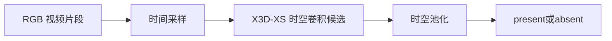

# Design: 存在性检测

## 范围与已有证据

本 change 统一管理单帧基线和 RGB 视频候选，原短视频 change 已合并。门控回答是否有宠物，不做身份、动作或框回归。输出 present/absent 概率与对应时间信息；遮挡、无效输入与不可测状态的表达须另行讨论，不能凭画面稳定就推断宠物离场。

已有单帧 MobileNetV3-Small 二分类模型；教师标签测试召回 0.973、FPR 估计 0.871，不能代替独立人工验收。原生画面教师标注、小目标分辨率问题、运动统计和既有训练记录保留在 evidence.md；历史记录中的旧编号不作为当前实施顺序。

## 速度优先的模型选择

### 单帧基线

RGB 整帧 [B,3,H,W] → MobileNetV3-Small → 空间池化 → 二分类头。复用 scripts/train_gate.py 的现有骨干和 checkpoint。禁止使用 followcam 作为存在性输入，因为门控先于定位。

### RGB 视频模型：X3D-XS

视频模型不复用或受限于已训图像骨干。当前建议 X3D-XS：RGB 序列 [B,3,T,H,W] → 轻量 3D 时空卷积 → 时空池化 → 二分类头；从官方 Kinetics 视频预训练权重初始化，替换分类头。官方构造默认4帧、160空间配置，Hub示例使用182预处理，两者不可混称固定唯一输入。建议两秒clip均匀取4帧，整幅画面等比缩放加边缘填充到审定空间尺寸，避免中心裁剪漏掉边缘宠物；这种预处理变更需要实测。小目标召回与实际延迟仍需验证，不宣称全球最快。官方来源：https://github.com/facebookresearch/pytorchvideo/blob/main/pytorchvideo/models/hub/x3d.py 。用户已确认采用X3D-XS；按阶段顺序，图片初评和视频标注完成后再训练。

### 首轮样本与标签建议

执行顺序由用户明确为图片标注→图片训练和初评→视频标注→经确认的视频模型训练和初评。每阶段建议400个样本，先按源视频划分为训练280、验证60、测试60；实际正负数与昼夜分布标后报告，不宣称少量样本给出最终置信结论。两个阶段尽量使用同一批源视频与固定split，但标签语义必须分别说明。

先分层抽200个源视频，按家庭、日期、昼夜覆盖，并包含真负候选，源内每阶段最多2个样本；短视频不足时少取并补其他源，不复制样本。图片取约1/3、2/3时刻，去重后不足400补源；视频长≥6秒时，在0至L-2秒范围取1/4、3/4位置为两段2秒clip起点，互不重叠；4≤L<6秒取原四分之一位置的一段；2≤L<4秒只取居中一个2秒clip；L<2秒首轮跳过。记录实际计数，400是目标而非保证。首轮不对2737段全量切片，不密集滑窗。

每张图片仅标该时刻present/absent。视频建议“完整两秒内出现过宠物即present，整个片段没有才absent”，已获用户确认并需在页面显著显示；它不表示片段末时刻在场。训练标签仅二类，无法判断时允许跳过待复核，不强迫猜测。先训练图片再开放视频批次，两个阶段分别汇报accuracy、recall、FPR、混淆矩阵和样本数，不仅报总体准确率。

### 标注窗口

复用现有 /gate/review 页面，增加图片/视频模式。视频显示单个可播放clip、重播/进度、present/absent按钮与P/A快捷键、跳过/上一条/保存进度；同一时刻不自动播放整页视频。不要求框或行为标签。后端沿用set/items/labels协议，新增安全的视频流接口，支持浏览器范围请求；路径限制在review根目录。图片标签保存完毕才能执行第一阶段训练；视频训练等待模型确认及视频标签冻结。

## 数据提取与组织

### 源数据与已有资产

主源为 pet-final 的 datasets/cat_raw：既有审计记录 2737 段、124 天、8+ 户码，含 164 段未标注视频；这是历史盘点，实施前需重新核实可达性和清单。老家 79 段按既有记录用于跨设备/家庭测试，不混入训练。未标注和行为区间之外都不等于无宠物。

已有 results/gate/dataset_v1/manifest.csv、帧资产、教师标签和 runs/ 模型可复用，但不得默认其 split 已满足新实验。训练入口 scripts/train_gate.py；人工核验集入口 scripts/prepare_gate_review_set.py；教师标注 scripts/label_gate_native.py。已有提帧入口的注释引用可能过时，实施前必须核实实际入口，缺失则按仓库规范补齐并提交后执行。

### 统一来源清单与划分

先建立 source_manifest.csv：source_id、source_path、household、camera_id、recording_date、duration、fps、width、height、domain、split、源文件指纹。未知设备等元数据显式标缺失，不猜填。

保留现有按日期隔离协议作为主域划分候选，同时按家庭报告结果；未见家庭/设备测试单列。先冻结 source_id/date 与 split 对应关系，再切帧/片段；同源视频、连续录制及重叠时间段不可跨 split。新旧数据近重复须核查，旧 checkpoint 若接触新测试源则只能作历史参考，公平对照需从相同初始化重训。

### 单帧数据路径

原视频 → 按真实时间戳顺序解码 → 1 fps 作为既有基线抽样起点 → 保存不裁剪的 RGB 整帧 → 关联教师与人工标签。保留原生源定位，存储长边 1280 的帧只作中间资产；如分辨率标定要求更大输入须从源重取，不把放大 JPEG 当高分辨率信息。

frames.csv 字段包括 frame_id、source_id、frame_idx、timestamp_sec、path、split、domain、teacher_label、human_label、review_status。teacher 与 human 分列，冲突与 uncertain 不静默合并。单帧标签为该时刻在场，不将整片段标签复制为所有帧真值。

### 视频数据路径

同一 source_manifest → 按审定窗长/步长生成 clips.csv → 保存源时间范围及采样帧的真实时间戳 → 按需取 RGB 帧。代理 H.264 小视频用于人工观看，模型输入可使用可追溯帧缓存；不得在训练时为每个重叠窗重复随机打开 HEVC 文件。

clips.csv 包含 clip_id、source_id、start_sec、end_sec、sample_timestamps、frame_ids、proxy_path、split、domain、label_scope、teacher_label、human_label、review_status。尾部不足窗口的处理需在试标前确定；不静默补帧、跨视频拼窗或把缺帧当 absent。视频增强对同一窗口使用一致几何及颜色参数，避免伪造运动。红外画面保持三通道 RGB 编码，不人为着色。

### 标注与目录

随机代表性样本和静止、小目标、夜视、遮挡、出入画难例分开登记；训练可主动挖难例，测试另报真实比例与分层表现。教师提供弱监督，人工核验真负样本及独立测试；视频辅助标注可用于确认某个时刻，并不必然要求视频模型。先小批试标测工时与一致性，再决定数量，不预承诺 2000 段或数小时。

新资产建议置于 results/gate/dataset_v2/：source_manifest.csv、frames.csv、clips.csv、frames/、proxies/、labels/、split.json、dataset_card.md。runs/<run_id>/ 保存 config、环境、指标、预测、阈值及 checkpoint；benchmark/<run_id>/ 保存测速。所有大产物不入 Git；历史 dataset_v1 不覆盖。

## 实验顺序与决策闸门

### 第一步：源数据和协议审计

核查现有文件、脚本与训练污染，用户确认标签语义、数据划分、采样/尺寸实验点、标注预算和质量门槛。输出数据卡与冻结协议；未确认的部分不得进入批量实施。

### 第二步：图片标注前的轻量预检

先核查图片标注入口与400样本候选是否可展示，不以视频测速阻塞图片标注和首轮训练。视频模型独立于图片权重。两条路线各自报告完整解码、预处理、缓冲、前向及内存；板端未测就标未测。视频准备可与图片阶段并行，用户标注视频及视频训练仍在图片初评之后。

### 第三步：图片标注与数据冻结

小批人工确认并记录工时，核验负样本，补静止/小目标等分层样本，确认预算后再扩量；冻结帧与片段清单、标签、split 和 hash。教师无检出不直接等于负例。

### 第四步：重建单帧质量基线

使用统一数据与输入尺寸，从同一图像预训练初始化训练单帧二分类。先保存配置、种子、环境与原始预测，再进行视频训练；现有模型成绩仅作参考。所有 GPU 训练/推理依远程技能执行，不在本地跑。

### 第五步：视频标注与视频训练

用户要求并行推进视频准备：片段提取入口、标注窗口及必要准备可以与图片阶段并行；图片初评完成后再请用户标注视频，标签冻结后训练视频模型。视频架构由用户确认，使用其自身预训练权重训练。两模型骨干不同，报告是方案对比，不归因为单一时序变量。报告额外数据曝光/帧数差异，不能宣称唯一变量是运动。重复帧/打乱序列诊断是否收益来自多个外观观察；若改尺寸或帧数，另立 run。

### 第六步：连续视频公平比较

按统一 label_scope 构造比较：若目标是窗口内出现，单帧模型须在相同采样点运行并给出明确聚合规则，同时保留单时刻基线；若目标是末时刻在场，单帧末帧与视频窗口比较。禁止比较不同语义。阈值只在 val 上选择，test 一次冻结评估；报告 recall/FPR、样本数、置信区间及昼夜/静止/小目标/遮挡/出入画结果；连续回放另报出现和离开延迟、漏在场时长、误放行时长和时间轴碎片。

原漏检≤2%是历史实验约束；本轮是否沿用须审定。系统准确率75%/漏检10%不能替代门控独立指标。只有同时满足审定质量与延迟预算才有切换资格，否则保留原方案与失败证据。

### 第七步：调度与设备验证

模型输入固定 RGB；像素变化触发、周期确认及缓存为独立调度变量，与不调度对照，不能取代模型。先固定模型再调周期与阈值，检查静止与出入画。选定路线再做导出、量化、实际开发板精度/延迟/内存复核及下游早退联调；未知语义、EOF、缺帧和重连规则须先讨论。

## 风险与待定事项

平均池化不理解帧序，短暂出现可能被稀释；静止宠物仍靠外观，小目标不能只靠更多帧弥补低分辨率。视频窗口新增缓冲及计算，等待延迟和服务耗时需分开。标注成本、视频最短帧数、标签语义、真实设备预算和验收阈值尚待确定。

## 迁移与历史

不覆盖现有 checkpoint 和 dataset_v1；新训练/集成待审定后实施。旧视频提案的模型候选、数据防泄漏、人工验收和完整测速要求已吸收；帧差方案删除，额外时序网络不进入首轮。既有 evidence.md 原样保留，仅追加合并记录。

## 参考

- [MobileNetV3-Small 官方接口](https://docs.pytorch.org/vision/main/models/generated/torchvision.models.mobilenet_v3_small.html)
- [TSM 论文](https://arxiv.org/abs/1811.08383)：仅后续参考，不作为本轮最快证据。

## 代码组织

已有前端 web/src/views/gate/GateReview.vue、API web/src/api/gateReview.js、后端 server/routers/gate_review.py；训练 scripts/train_gate.py，教师标注 scripts/label_gate_native.py，核验集准备 scripts/prepare_gate_review_set.py，测速 scripts/bench_gate_latency.py。已有运动实验位于 scripts/checks/motion_vs_labels.py 与 motion_stats_windowed.py。

新增可复用门控模型逻辑建议放 petlib/gate/，共享变化检测建议放 petlib/motion/（Terra核查后再定接口）；正式准备和训练入口留 scripts/，预检/测速核验归 scripts/checks/，测试归 tests/，产物归 results/gate/。不修改只读 models/mmaction2/，不在系统/tmp写可复用脚本。

## Terra变化检测核查

GroundingDINO 在 scripts/pet_detect_track.py 按 sample_stride 固定抽样执行；可选 motion-correct 中的 MOG2 只修正插值框，不触发GDINO。petlib/detection/grounding_dino.py 只有单帧检测接口。scripts/checks/motion_vs_labels.py 和 motion_stats_windowed.py 是离线运动实验，不是线上门控。

建议复用帧差/前景计算原语与标准输出，独立保留门控调度、背景重分割触发和轨迹修正策略。MOG2状态需按视频源隔离、连续预热；现有窗口实验的跨视频状态，以及轨迹修正的抽样帧不更新/预热问题，在共享化前审计。像素变化层保留，但低变化不等于无宠物，仍须周期模型确认。此项只读结论不等于已完成代码重构。

## 实施授权记录

用户认可400图片后400视频、X3D-XS、片段内出现即present以及首轮先图片后视频的流程。2026-10-30远程GPU容量预检拒绝后，用户另行批准“仅CPU提取图片，不训练”。因此可以在保持CPU/RSS/时长守卫的情况下跳过GPU占用前置，但不授权GPU训练。首次CPU提取因解码线程超过200%上限被守卫终止，需修正线程限制后重试，不提高上限。
